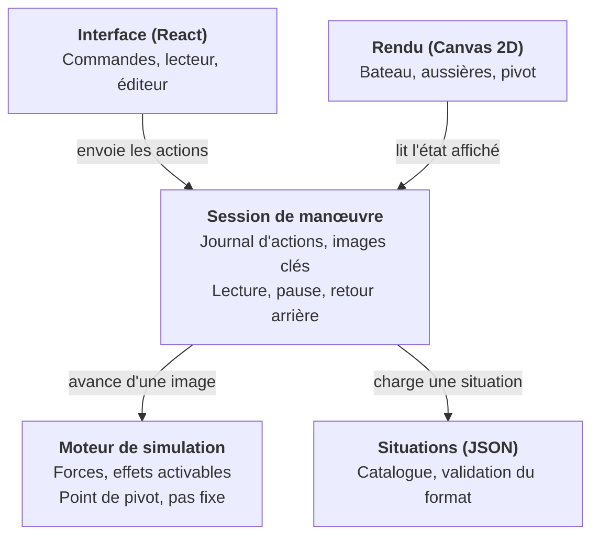

# Mini Cassiopée — Architecture technique

Ce document traduit les [spécifications](specifications.md) en choix techniques. Il est tenu à jour dans les demandes de fusion qui modifient l'architecture.

## Synthèse

Mini Cassiopée est une application web statique, sans serveur, écrite en TypeScript, dont le cœur est un moteur de simulation maison isolé de l'affichage.

- **Moteur de simulation maison**, en TypeScript pur, sans dépendance au navigateur : corps rigide 2D, pas de temps fixe, aussières en traction seule, contact simple avec le quai.
- **Effets physiques activables** : chaque enrichissement (pas d'hélice, fardage, puis bi-safran) est un module qu'on branche ou non, sans toucher au socle.
- **Relecture par journal d'actions et images clés**, qui rend le retour arrière fiable et peu gourmand en mémoire.
- **Situations décrites en JSON**, chargées par le catalogue et, à terme, produites par l'éditeur.
- **Rendu Canvas 2D**, interface en React, construction avec Vite.
- **Application web hébergée sur GitHub Pages** et déployée automatiquement par GitHub Actions ; installable sur l'écran d'accueil et utilisable hors ligne grâce à un service worker écrit à la main.

Le code est publié sous licence MIT. Seule la licence des contenus pédagogiques reste ouverte, dans le registre des décisions en fin de document.

## Vue d'ensemble

L'application se découpe en cinq modules ; le moteur de simulation, au centre du projet, n'en connaît aucun autre.



Chaque flèche va d'un module vers ce dont il dépend. L'interface et le rendu ne touchent jamais directement au moteur : ils passent par la session, qui seule fait avancer la simulation et tient l'historique.

## Moteur de simulation

Le moteur est écrit sur mesure plutôt qu'adossé à une bibliothèque physique (Planck.js, Matter.js, Rapier). Environ 200 lignes suffisent, et un moteur maison garde la main sur ce qui compte ici : aussières en traction seule, résistance latérale répartie qui place le pivot, contact avec le quai servant de point d'appui.

### Repères et unités

- Unités SI : mètres, secondes, newtons, radians. L'interface convertit (degrés, nœuds) à l'affichage.
- Repère monde : x le long du quai, y vers le quai, bord du quai en y = 0. En situation libre, le bateau part de l'origine, étrave vers +y (le haut de l'écran), et y = 0 n'est le bord de rien.
- Repère bateau : x vers l'avant, y vers bâbord. Cap 0 : étrave vers +x.

### Modèle

- Corps rigide plan à trois degrés de liberté (x, y, cap), masses différentes en longitudinal et en latéral pour tenir compte de l'eau entraînée.
- Intégration d'Euler semi-implicite à pas fixe de 1/240 s, quatre sous-pas par image de 1/60 s. Le pas ne dépend jamais de la fréquence d'affichage.
- Forces du socle : moteur, safran, résistances longitudinale et latérale, portance de la quille, vent au centre, aussières, contact et frottement sur le quai et le catway, contact avec les voisins.
- Safran : traité comme un aileron, dont l'incidence a deux causes. La barre, avec le flux d'hélice en marche avant (vitesse déduite de son effet, `washSpeed`) et l'erre, signée : en marche arrière, la barre agit dans l'autre sens. Et l'eau qui arrive de côté quand l'arrière dérape (`v + w · xRudder`) : le safran s'y oppose d'autant plus que l'eau passe vite (`rudderGrip`), ce qui freine le dérapage et resserre la giration.
- Quille : en route, elle s'oppose au dérapage en proportion de la vitesse longitudinale (`keelLift`), comme une aile. Son centre de poussée se porte vers l'extrémité qui ouvre la route (`keelShift`) : c'est ce qui place le pivot dans la moitié avant en marche avant et dans la moitié arrière en marche arrière. Bateau arrêté, elle ne porte pas.
- Résistance latérale : répartie en tranches le long de la coque, concentrée vers le milieu où la quille et le tirant d'eau la portent (`dragYCenter`, `sliceWeights`), et faible aux extrémités. Son total ne dépend pas de cette répartition : la dérive au vent du bateau arrêté non plus.
- Quai : l'état porte un booléen `quay`, faux en situation libre seulement. L'effet `quayContact` n'ajoute alors rien et vide la liste des appuis : ce n'est pas un effet optionnel mais un élément de la scène, présent par défaut.
- Catways : l'état porte une liste `catways`, vide le long du quai : le catway du bateau et le second, côté large, puis, s'il y a des bateaux en face, les deux catways de la panne d'en face. Chacun est un rectangle immobile accroché par son pied (`y`) au bord du quai ou de la panne, qui s'avance dans l'eau dans un sens (`dir` : -1 vers le bas depuis le quai, 1 vers le haut depuis la panne d'en face) sur une longueur fixe, à une abscisse donnée. L'effet `catwayContact` les traite comme le quai : il repousse les points de la coque entrés dans un rectangle selon le flanc ou le bout le plus proche, et la coque là où un angle du bout d'un catway y est entré ; le pied n'est pas une sortie, le quai ou la panne ayant leur propre contact. Ses points d'appui rejoignent ceux du quai (`contacts`). Sans catway, l'effet n'ajoute rien.
- Pannes : l'état porte une liste `pannes` de rectangles immobiles (`x0`, `x1`, `y0`, `y1`), vide sauf s'il y a des bateaux en face : la panne d'en face. Le même effet `catwayContact` la traite comme un catway sans pied : il repousse les points de la coque entrés selon le côté le plus proche, et la coque là où un angle de la panne y est entré. Sans panne, rien n'est ajouté.
- Bateaux voisins : l'état porte une liste `neighbors` de coques identiques et immobiles (position et cap fixes). L'effet `neighborContact` les traite comme le quai : ressort amorti qui ne tire jamais, plus frottement, appliqué à chaque point de la coque entré dans un voisin et, en sens inverse, là où un point d'un voisin est entré dans la coque (un angle de tableau contre le flanc). La coque étant convexe, la pénétration se mesure sous l'arête la plus proche (`hullPenetration`, dans `src/sim/geometry.ts`). Les points touchés sont gardés par voisin pour l'affichage. Sans voisin, la liste est vide et l'effet n'ajoute rien : ce n'est pas un effet optionnel mais un élément de la scène, absent par défaut. Les bateaux d'en face sont des voisins comme les autres (identifiants `face-1` à `face-4`) : même contact, même signalement.
- Aussières : ressort amorti qui ne travaille qu'en traction. Chacune a un mode (`mode`, type `LineMode`), ce que fait l'équipier qui tient le bout : `bloque` (par défaut), `choque` ou `reprend`. Choquée, elle file sans retenue : à chaque sous-pas, sa longueur rejoint la distance du taquet à la bitte dès que le bateau s'en éloigne, et ne raccourcit jamais. Reprise (#22), elle raccourcit de `haulSpeed` (0,3 m/s) à chaque sous-pas tant que la tension du sous-pas précédent reste sous l'effort de l'équipier (`crewEffort`, 600 N), sans descendre sous `lineMinLen` (1 m, le taquet contre la bitte) : elle rattrape le mou, puis reste raide. L'équipier ressent la tension lissée sur `crewHold` (0,5 s, champ `load` de l'aussière) : il encaisse ainsi l'à-coup bref du mou qui se rattrape. Quand cette tension ressentie dépasse son effort de plus de `crewMargin` (25 %), il lâche : le mode passe de lui-même à `choque`, dans la simulation, sans action de l'élève, ce qui garde la relecture exacte (comme la fin d'un coup de fouet). La marge évite qu'il lâche à la fin de sa propre reprise. Après chaque image, `tick` note dans `rate` la variation de longueur de chaque aussière (m/s), que lit l'affichage. Ce n'est pas un effet optionnel mais un état de l'aussière, changé par une action de l'élève ou par le lâcher.
- Moteur et ralenti : `engine` vaut -1 (marche arrière), -0,5 (ralenti arrière), 0 (neutre), 0,5 (ralenti avant) ou 1 (marche avant), dans cet ordre (`ENGINE_POSITIONS`). Son signe donne le sens de la poussée ; au ralenti, `thrustOf` la multiplie par `idleFactor` (0,5), et le flux d'hélice au safran (`washSpeed`) et le pas d'hélice suivent, comme pour le coup de fouet. Ce n'est pas un effet optionnel mais une position de la commande : en marche, le facteur vaut 1 et rien ne change.
- Coup de fouet : état du moteur (`kick`, nul hors d'un coup), pas un effet optionnel. Pendant un coup, la poussée a le sens du coup et est multipliée par `kickFactor` (2) ; le flux d'hélice au safran (`washSpeed`) et le pas d'hélice suivent, puisqu'ils dépendent de la poussée. `engine` garde la position où le moteur reviendra, ralenti compris ; depuis le ralenti, le coup garde le facteur `kickFactor`, le double de la marche. Un coup donné depuis cette position ou dans son sens dure `kickTime` (2 s). À contre-sens (signe de `engine` opposé au coup), `engine` passe au neutre et le coup casse l'erre : il s'arrête dès que la vitesse longitudinale ne va plus dans le sens de l'ancienne marche, au plus tard après `kickMaxTime` (5 s) ; si elle était déjà presque nulle (moins de 5 cm/s, `KICK_ERRE_MIN`), il dure `kickTime`. Un nouveau coup remplace le précédent selon les mêmes règles, depuis `engine` ; une action moteur l'annule. Le démarrage (`startKick`) est appliqué par l'action de l'élève, sans les paramètres ; la fin (`updateKick`) est vérifiée par `tick` à chaque image, avec le compte des images écoulées, ce qui garde la relecture exacte. Fonctions dans `src/sim/kick.ts`, sens et facteur de la poussée du moment donnés par `thrustOf`.
- Point de pivot calculé à chaque image : point de l'axe dont la vitesse latérale est nulle, lissé et masqué quand le bateau translate sans tourner. L'affichage le borne à la coque, de l'étrave à l'arrière ; le montrer hors de la coque est une option envisagée (#45).

### Effets activables

Chaque force est un **effet** (`src/sim/effects.ts`) : une fonction qui reçoit l'état et les paramètres, et ajoute une force et un moment. Le socle en active une liste fixe, dans un ordre fixe. Les effets optionnels sont déclarés dans la situation, sous `options`, et recopiés dans l'état (`options`, fixé pour toute la manœuvre et conservé dans les images clés). `activeEffects(state)` renvoie le socle suivi des effets optionnels activés, toujours dans le même ordre ; c'est la liste qu'utilise `tick` par défaut. Sans option, c'est exactement la liste du socle : le comportement de base ne change pas.

| Effet | Principe | Statut |
| --- | --- | --- |
| Pas d'hélice (`propWalk`) | Poussée latérale à l'hélice (`xProp`) quand le moteur tourne. Hélice à droite (`options.propWalk = 'droite'`), l'arrière part vers bâbord en marche arrière (`propWalkRev`) ; en marche avant, effet plus faible et de sens contraire (`propWalkFwd`). Hélice à gauche, tout s'inverse. La poussée est divisée par 1 + (u / `propWalkSpeed`)² : maximale bateau arrêté, elle faiblit avec l'erre, si bien que la barre reprend le dessus. Au ralenti, elle est multipliée par `idleFactor`, pendant un coup de fouet par `kickFactor`, comme la poussée | Livré |
| Bi-safran | Safrans hors du flux d'hélice (`washSpeed` nulle) : effet de barre et tenue au dérapage seulement avec de l'erre | Envisagé |
| Fardage (`windage`) | Le vent, appliqué au centre par le socle, reçoit un moment : sa force latérale s'applique en `windageX` + `windageShift` × cos β le long de l'axe, β étant l'angle d'où vient le vent compté depuis l'étrave. Le point se porte vers le bout qui reçoit le vent : l'équilibre étrave au vent devient instable et le bateau arrêté finit à peu près en travers. Vent dans l'axe, rien ne brise la symétrie : l'effet ajoute le moment d'un vent arrivant de `windageSkew` sur le côté tiré (`options.windage`, 1 : l'avant abat vers bâbord, -1 vers tribord), pondéré par cos² β pour s'effacer par le travers. Le côté est tiré au hasard par l'interface à chaque nouvelle session (`buildState(situation, vent, abattee)`), noté dans l'état initial et rejoué à l'identique ; le moteur, lui, reste sans hasard | Livré |

### Paramètres

Les constantes physiques (poussée, efficacité de barre, résistances, vent, raideur des aussières) sont regroupées dans un seul jeu de paramètres (`src/sim/params.ts`), versionné avec le code. Un panneau de réglages, accessible en ajoutant `#reglages` à l'adresse de l'application, permet de les affiner.

#### Ordres de grandeur

Les valeurs par défaut ont été réglées pour que pivots et translations soient plausibles, pas à partir de mesures. Les équivalences ci-dessous servent seulement de repères pour en parler ; elles reposent sur des hypothèses grossières.

| Paramètre | Valeur | Équivalent indicatif |
| --- | --- | --- |
| Poussée en marche avant (`thrustFwd`) | 1 375 N, environ 140 kgf | Moteur de 20 à 30 ch à bas régime, comme en manœuvre de port (on compte 8 à 10 kgf de poussée au point fixe par cheval). Vitesse limite du bateau libre : environ 3,1 nœuds |
| Poussée en marche arrière (`thrustRev`) | 935 N, environ 95 kgf | Vitesse limite du bateau libre : environ 2,5 nœuds |
| Vent faible (`windFaible`) | 300 N par le travers | Environ 10 à 11 nœuds (force 3 à 4). Dérive du bateau libre : environ 0,2 nœud |
| Vent soutenu (`windSoutenu`) | 900 N par le travers | Environ 18 à 20 nœuds (force 5). Dérive du bateau libre : environ 0,5 nœud |
| Vent dans l'axe (`windLongRatio`) | 35 % de la force par le travers | Fardage plus faible de face que de travers |
| Giration barre à fond, marche avant | Diamètre de 19 m (1,9 longueur), pivot 2,3 m en avant du centre | Demi-tour depuis l'arrêt avec 19 m de décalage latéral, en 26 s ; dérive de 14° en giration |
| Giration barre à fond, marche arrière | Diamètre de 22 m (2,2 longueurs), pivot 1,1 m en arrière du centre | Demi-tour depuis l'arrêt avec 23 m de décalage latéral, en 38 s |
| Dérive sous moteur, vent soutenu par le travers | Cap tenu à la barre : environ 2° en marche avant, 5° en marche arrière | À l'arrêt, le bateau dérive à 0,5 nœud comme sans quille portante |
| Pas d'hélice en marche arrière (`propWalkRev`) | 440 N à l'hélice, bateau arrêté ; moitié moins à 0,8 m/s d'erre (`propWalkSpeed`) | Option activée, depuis l'arrêt, barre au centre : environ 8° de cap en 5 s et 13° en 8 s, le temps de reculer de 4 m. Barre à fond dans l'autre sens dès le départ, l'arrière part d'abord de côté, puis la barre reprend le dessus vers 7 s |
| Pas d'hélice en marche avant (`propWalkFwd`) | 66 N à l'hélice, de sens contraire | Environ 1° de cap en 5 s, barre au centre : à peine visible |
| Fardage (`windageX`, `windageShift`, `windageSkew`) | Point d'application à 4,5 m en avant du centre vent de face, 0,5 m par le travers, 3,5 m en arrière vent arrière ; déclencheur de 0,07 rad (4°) | Option activée, bateau libre arrêté, vent soutenu de face : environ 8° de cap en 10 s, près de 40° en 20 s, presque en travers en 30 s, puis stable, le vent 5 à 10° sur l'arrière du travers. Vent faible : 45° en 45 s. Vent soutenu par le travers sous moteur, barre au centre : cap tenu à quelques degrés, au lieu de remonter au vent |
| Ralenti (`idleFactor`) | Poussée divisée par deux : 690 N en avant, 470 N en arrière, pas d'hélice et flux d'hélice au safran compris | Vitesse limite du bateau libre : environ 2,1 nœuds en avant, 1,7 en arrière. Pas d'hélice, ralenti arrière depuis l'arrêt, barre au centre : environ 4° de cap en 5 s et 8° en 8 s, contre 8° et 13° en marche arrière. Sur la garde avant, l'arrière s'écarte de 0,4 m en 5 s, contre 0,8 m. Garde avant au maître-bau, barre au large : le bateau tient le long du quai, la garde travaille à 700 N au lieu de 1 400 |
| Équipier (`crewEffort`, `haulSpeed`, `crewMargin`, `crewHold`, `lineMinLen`) | Effort de 600 N, lâcher au-delà de 750 N ressentis ; reprise à 0,3 m/s, jusqu'à 1 m de longueur | Un équipier qui embraque à la main. Traversier au maître-bau, bateau à 2 m du quai : sans vent, il rapproche le bateau d'environ 0,15 m/s ; contre un vent faible qui l'écarte, d'environ 0,08 m/s. Contre un vent soutenu, il lâche en 1 à 2 s une fois le mou rattrapé ; sur la garde avant, contre la marche avant, en moins d'une seconde, et contre le ralenti avant en 3 à 4 s |
| Coup de fouet (`kickFactor`, `kickTime`, `kickMaxTime`) | Poussée doublée : 2 750 N en avant, 1 870 N en arrière ; 2 s, ou jusqu'à 5 s à contre-sens | Moteur de 20 à 30 ch à régime appuyé. Bateau libre arrêté, barre à fond, coup avant : 6° de cap en 2 s, contre 3° en marche avant simple, avec 0,8 m/s d'erre au lieu de 0,4. Sur la garde avant, l'arrière s'écarte de 0,26 m en 2 s, contre 0,12 m. Lancé en avant à 1,6 m/s (3,1 nœuds), un coup arrière arrête le bateau en 4,5 s |

Hypothèses : pour le vent, surface exposée par le travers de 15 à 18 m² (coque et gréement) et coefficient de traînée proche de 1 ; les vitesses limites et les dérives découlent des résistances du modèle (`dragXq`, `dragXl`, `dragYq`, `dragYl`). La giration découle du safran (`rudderFlow`, `rudderWash`, `rudderGrip`), de la quille (`keelLift`, `keelShift`) et de la répartition de la résistance latérale (`dragYCenter`), réglés sur les repères de la littérature pour un voilier de 10 m à quille aileron : diamètre d'environ deux longueurs barre à fond, presque aussi manœuvrant en arrière qu'en avant, pivot vers le tiers avant en marche avant et vers l'arrière en marche arrière.

Vitesse de manœuvre (#44) : la poussée a été abaissée pour que le bateau libre plafonne vers 3 nœuds, l'allure d'une manœuvre de port, au lieu de 4,3. Le vent a été abaissé un peu moins que la poussée (×0,65 contre ×0,55) : à faible vitesse, la résistance latérale de la coque est surtout linéaire, si bien qu'un vent abaissé dans le même rapport ferait dériver le bateau proportionnellement moins, et le vent perdrait le poids qu'il prend sur l'eau quand on manœuvre lentement. Le pas d'hélice, qui dépend du régime, suit la poussée.

Ralenti (#67) : un second régime, à moitié de la poussée, s'ajoute à la marche sans la modifier. Il rend le pas d'hélice dosable, plus discret au ralenti comme sur un vrai bateau, et gradue l'échelle : ralenti, marche, coup de fouet. Le constat de l'issue, sur catway étrave au quai et hélice à droite, reste vrai au ralenti : retenu par l'avant, le bateau finit par amener l'arrière sur le bout du catway, mais deux fois plus lentement, ce qui laisse le temps d'agir.

Conséquences pour la pédagogie :
- le vent « faible » est une petite brise, le vent soutenu un vent frais ;
- le vent soutenu vaut environ les deux tiers de la poussée avant et presque toute la poussée arrière, ce qui rend le recul au vent difficile, comme sur l'eau ;
- tout se passe plus lentement qu'avant : le départ sur garde demande quelques secondes de plus, et le coup de fouet, qui double la poussée, donne le coup de moteur franc qui redonne de la manœuvrabilité ;
- le bateau fait demi-tour dans une allée de port réaliste ; sous moteur, il remonte légèrement au vent, sauf avec le fardage (#12), qui fait abattre l'avant.

## Historique et relecture

Une manœuvre est enregistrée comme une situation de départ plus un journal horodaté des actions de l'élève, complété d'images clés de l'état (`src/session/session.ts`). C'est ce qui permet pause, pas à pas et retour arrière sans conserver chaque image.

- **Journal d'actions** : chaque action (moteur, ralenti compris, coup de fouet, barre, largage, cran d'une aussière) est notée avec le numéro d'image où elle s'applique. Le cran d'une aussière est une seule action, `line-mode`, qui porte le mode choisi (`choque`, `bloque` ou `reprend`) ; elle remplace l'action `pay-out` (booléen) de #13. Le lâcher de l'équipier n'est pas une action : la simulation le rejoue d'elle-même.
- **Images clés** : l'état complet est sauvegardé toutes les 60 images (1 s). Pour afficher l'image n, on repart de l'image clé précédente et on resimule au plus 59 images, ce qui reste imperceptible.
- **Embranchement** : une action faite après un retour arrière efface la suite du journal et des images clés, puis la manœuvre repart de ce point.
- **Mémoire** : un état tient en moins de 200 octets ; un quart d'heure de manœuvre représente environ 900 images clés, soit moins de 200 ko.

La resimulation exige que le moteur soit déterministe sur un même appareil : pas de hasard, pas de dépendance à l'horloge, ordre de calcul fixe. Une relecture ne sort jamais de l'appareil, donc les écarts infimes de calcul entre navigateurs ne posent pas de problème.

## Format des situations

Chaque situation du catalogue est un fichier JSON lisible à la main, dans `src/situations/catalogue/`. Le moteur ne connaît que ce format, ce qui découple le catalogue, l'éditeur et une éventuelle fonction de partage future.

```json
{
  "format": 1,
  "id": "depart-garde-avant",
  "titre": "Départ sur garde avant",
  "description": "Seule la garde avant est tournée. Marche avant : l'étrave s'appuie sur le quai et l'arrière décolle.",
  "quai": { "type": "long-side" },
  "bateau": { "x": 0, "distanceQuai": 0.05, "bordAuQuai": "babord" },
  "aussieres": [
    { "id": "garde-av", "taquet": "etrave", "bitte": -4, "mou": 0 }
  ],
  "vent": { "direction": "quai", "force": "aucun" }
}
```

- `quai.type` vaut `long-side`, `perpendiculaire` ou `libre`. En `libre`, le bateau n'est amarré nulle part : `bateau` est absent, `aussieres` est une liste vide, `voisins` et `plafondAussieres` sont refusés. La validation complète la situation lue d'un `bateau` neutre (`BATEAU_LIBRE`), jamais écrit dans un fichier, pour que les fonctions qui l'attendent restent valables ; seule `poseDepart` le lit, pour placer le bateau à l'origine, cap π/2. En perpendiculaire, le bateau est amarré le long d'un catway, long des 2/3 du bateau (`LONGUEUR_CATWAY`) ; on appelle **support** le bord le long duquel il est amarré : le quai le long du quai, le catway en perpendiculaire.
- `bateau.x` est la position du centre du bateau le long du support. Le long du quai, c'est l'abscisse monde. En perpendiculaire, c'est la distance au bord du quai, comptée le long du catway vers le chenal ; le bout du bateau côté quai doit en rester à 0,5 m au moins (`ECART_QUAI_MIN`).
- `bateau.distanceQuai` est l'écart entre le flanc et le support : le bord du quai, ou le flanc du catway.
- `bordAuQuai` vaut `babord` ou `tribord` : le flanc tourné vers le support.
- `bateau.boutAuQuai`, en perpendiculaire seulement et obligatoire, vaut `etrave` ou `arriere`.
- `taquet` vaut `etrave` ou `arriere` (côté quai ou catway), `etrave-large` ou `arriere-large` (côté large), `maitre-bau` (côté quai ou catway) ou `maitre-bau-large`. L'éditeur propose les six taquets, quelle que soit la situation. Ceux du maître-bau sont au milieu de la coque, au plus large.
- `bitte` est la position de la bitte le long du support, en mètres, depuis le centre du bateau au départ, positive vers l'avant. Sa position le long du support (`bateau.x` plus ou moins `bitte` selon le sens de l'étrave) doit tomber sur une bitte du support. Le long du quai, c'est un multiple de l'espacement, 2 m (`BOLLARD_SPACING` dans `src/situations/quai.ts`, avec les conversions entre position relative et position le long du support). Sur le catway, c'est l'une de ses deux bittes, au milieu et près du bout (`BITTES_CATWAY` : 3,3 m et 6,4 m du bord du quai).
- `sur` est facultatif, en perpendiculaire seulement : `quai` pour une bitte de la rangée du quai. `bitte` est alors sa position le long du quai depuis l'axe du bateau, positive vers le catway, et sa position monde doit tomber sur la rangée du quai : une bitte dans l'alignement de chaque bord de catway, puis tous les 2 m (`bittesQuai`). Absent, la bitte est sur le support.
- Deux aussières ne peuvent pas relier le même taquet à la même bitte.
- `nom` est facultatif : absent, il est déduit de la géométrie au départ (voir l'édition ci-dessous) ; présent, c'est le nom choisi par l'auteur ou l'élève.
- `mou` vaut 0 pour une aussière tendue au départ, ou la longueur de mou en mètres. L'éditeur ne produit que 0 (tendue) ou 0,5 (molle) ; le catalogue peut utiliser d'autres valeurs.
- `equipier` est facultatif : ce que fait l'équipier dès la mise en mouvement, `choque` (l'aussière file) ou `reprend` (il l'embraque) ; absent, elle est bloquée. L'ancien champ `file` reste lu : `true` vaut `choque`, `false` est ignoré, et il est refusé s'il contredit `equipier`. Le validateur ne garde que `equipier`.
- `plafondAussieres` est facultatif : nombre maximal d'aussières de la situation, entier de 6 à 12, 6 par défaut, jamais inférieur au nombre d'aussières déclarées.
- `voisins` est facultatif, chaque côté aussi ; un objet vide ne déclare aucun voisin. Le long du quai : `{ "avant": écart, "arriere": écart }`. L'écart, en mètres de 0,5 à 20, sépare l'étrave (ou le tableau arrière) du bateau au départ de l'extrémité du voisin. Le voisin a la même coque, le même cap et le même écart au quai que le bateau (`xVoisin` dans `src/situations/quai.ts`). En perpendiculaire : `{ "catway": distance, "large": distance }`. Le voisin côté catway est amarré de l'autre flanc du catway du bateau, le voisin côté large contre le second catway, chacun au même écart de son catway que le bateau (`distanceQuai`) et toujours étrave au quai ; la distance, de 0,5 à 5 m, sépare son étrave du bord du quai (`poseVoisin`). Un voisin côté large est refusé si le bateau, trop écarté de son catway, laisse moins de 0,5 m entre les coques (`ecartVoisinLarge` : 0,6 m pour l'écart de 0,3 m du catalogue).
- `enFace` est facultatif, en perpendiculaire seulement : distance en mètres du bord du quai aux arrières des bateaux d'en face, de l'autre côté de l'allée ; absent, pas de bateaux en face. L'allée, entre le bout du bateau côté chenal et ces arrières (`enFace` − `bateau.x` − 5), doit mesurer de 5 à 40 m. La rangée d'en face est fixe : panne de 2 m de large (`LARGEUR_PANNE`), deux catways dans l'alignement de ceux du bateau, tournés vers l'allée, et quatre bateaux étrave à la panne, à 1 m d'elle (`ECART_PANNE`) et à 0,3 m de leur catway (`ECART_CATWAY_EN_FACE`), un de chaque côté de chaque catway ; la panne dépasse de 1 m les coques extrêmes (`geometrieEnFace`).
- `options` est facultatif : effets avancés de la situation. `{ "pasHelice": "droite" }` ou `"gauche"` active le pas d'hélice (#10) ; absent, pas de pas d'hélice. `{ "fardage": true }` active le fardage (#12) ; le validateur ne garde que `true`. Les deux se combinent. Une option inconnue est refusée. Les situations du catalogue n'en déclarent pas.
- `vent.direction`, le long du quai, vaut `quai`, `large`, `avant`, `arriere` ou une combinaison (`quai-avant`, `large-arriere`…) ; `avant` et `arriere` se rapportent au cap du bateau au départ. En perpendiculaire, elle vaut `catway`, `large` (côté opposé au catway), `quai`, `chenal` ou une combinaison (`catway-quai`, `large-chenal`…). En `libre`, elle vaut `avant`, `arriere`, `babord`, `tribord` ou une combinaison (`avant-babord`, `arriere-tribord`…), par rapport au bateau au départ. `vent.force` vaut `aucun`, `faible` ou `soutenu`.
- `format` permet de faire évoluer le schéma en gardant la lecture des anciennes situations.

```json
{
  "quai": { "type": "perpendiculaire" },
  "bateau": { "x": 6, "distanceQuai": 0.3, "bordAuQuai": "babord", "boutAuQuai": "etrave" },
  "aussieres": [
    { "id": "pointe-av", "taquet": "etrave", "sur": "quai", "bitte": 2, "mou": 0 },
    { "id": "garde-av", "taquet": "etrave", "bitte": 2.7, "mou": 0 }
  ],
  "vent": { "direction": "catway", "force": "faible" }
}
```

Évolutions prévues : `quai` accueillera `longueurCatway` (#29), sans changer la rangée d'en face ; le bi-safran (#11) s'ajoutera sous `options`.

Une fonction de validation (`src/situations/schema.ts`) accompagne le format ; une situation invalide est refusée au chargement avec un message lisible. Les nouvelles règles (bitte sur la rangée, doublons, plafond, nom facultatif, voisins, catway, voisins sur catway, options, situation libre, bateaux en face) restent compatibles avec le format 1 : seul le catalogue existant est recalé sur la rangée de bittes.

La géométrie du port est regroupée dans `src/situations/quai.ts` : sens de l'étrave le long du support (`bowSign`), position monde d'une bitte (`pointBitte`), axes des catways (`axesCatways`), place des voisins (`poseVoisin`, `ecartVoisinLarge`), panne, catways et bateaux d'en face (`geometrieEnFace`, `distanceEnFace` pour une largeur d'allée), rangée du quai (`bittesQuai`), bittes proposées (`bittesDuPort`) et bittes des autres catways, second catway et catways d'en face (`bittesAutresCatways`), bitte touchée dans l'éditeur (`bitteDepuisPoint`), et position d'une bitte dans le repère du bateau tourné vers le support (`bitteRepereBateau`), qui sert au nom déduit. Le catway du bateau a son axe en x = 0 ; le bateau est placé d'un côté ou de l'autre selon le bord au catway et le bout au quai, et le second catway est de son côté large, à 8 m de bord à bord (`ECART_CATWAYS`). En situation libre (`libre`), il n'y a ni rangée ni bitte : `bittesQuai` et `bittesDuPort` sont vides, et `poseDepart` place le bateau à l'origine, étrave vers +y.

### Édition de la situation

L'éditeur produit des situations au même format que le catalogue. Les opérations sont des fonctions pures sur une `Situation` (`src/situations/edit.ts`), sans dépendance au navigateur et testables seules :

- `ajouterAussiere(situation, taquet, bitte, sur)`, refusée avec un message lisible en cas de doublon ou de plafond atteint ;
- `supprimerAussiere`, `basculerMou` (tendue ou 0,5 m de mou), `reglerEquipier(situation, id, equipier)` (bloquée avec `null`, choquée ou reprise au départ), `renommerAussiere`, `reglerPlafond` ;
- `reglerPasHelice(situation, sens)` : `droite`, `gauche` ou `null` (aucun) ; `reglerFardage(situation, actif)` : avec ou sans fardage. Chacune garde les autres options ; sans option, le champ `options` disparaît de la situation ;
- `nomDeduit(situation, aussiere)` : traversier si l'aussière fait moins de 20° avec la perpendiculaire au bateau, sinon pointe ou garde selon que la bitte est en dehors ou en dedans du taquet le long du bateau, avant ou arrière selon le taquet. Au maître-bau, c'est un traversier ou une garde au maître-bau, avant si la bitte est en arrière du taquet (elle empêche d'avancer, comme la garde avant), arrière sinon. Le calcul se fait en repère bateau, ce qui le rend indépendant du bord au quai ; en perpendiculaire, il s'applique tel quel aux bittes du catway comme à celles du quai. `nomsAffiches(situation)` garde les noms choisis ; il départage les noms déduits identiques par leur bord (`bordAussiere` : celui du taquet) quand chacun est sur un bord différent, et sinon les numérote ; `buildState` l'utilise pour nommer les aussières de la simulation ;
- `taquetsProposes(situation)` : les taquets offerts à l'éditeur et leur position, selon le bord au quai ; aucun en situation libre ;
- `changerBord(situation, origine, bord)` : retourne le bateau, bâbord ou tribord au support. Les aussières gardent leur `taquet`, leur `bitte` relative et le reste : comme ces valeurs se rapportent au bateau, elles passent en miroir sur la bitte symétrique. Le vent reste fixe dans le repère monde : sa direction échange `avant` et `arriere` le long du quai, `catway` et `large` en perpendiculaire. Le long du quai, les voisins restent en place, retournés comme le bateau puisque leur cap est celui du bateau (`poseVoisin`) : leurs écarts `avant` et `arriere` s'échangent. En perpendiculaire, ils suivent le bateau sans changement, comme le second catway. Le long du quai, quand le miroir d'une bitte tomberait hors de la rangée (bateau sur un demi-mètre), le bateau se décale de 1 m vers sa position d'origine, aussières comprises et voisins en place, dans les bornes de `bornesDeplacement` ; refusé avec un message lisible si aucune place ne convient ;
- `deplacerBateau(situation, origine, x)` : place le bateau en `x` le long du support, arrondi au pas de 0,5 m (`PAS_DEPLACEMENT`) et borné à 4 m (`DEPLACEMENT_MAX`) autour de la position de la situation d'origine, à 0,5 m au moins de chaque voisin et, en perpendiculaire, du quai (`bornesDeplacement`, qui sert aussi aux boutons ◀ ▶ ou ▲ ▼). Les aussières tournées sur le quai en perpendiculaire gardent leur `bitte`, l'axe du bateau ne bougeant pas le long du quai. Les aussières gardent leur bitte dans le repère monde : leur `bitte` relative est recalculée, et la longueur et le nom déduit suivent à la construction de l'état. Les voisins restent eux aussi en place : leur écart est recalculé. La fonction renvoie la même situation quand la position ne change pas, ce qui évite une session inutile pendant un glisser.
- en situation libre, `ajouterAussiere`, `changerBord` et `reglerVoisin` sont refusés avec un message lisible ; `deplacerBateau` renvoie la situation inchangée et `bornesDeplacement` réduit la course à la position d'origine ;
- `reglerVoisin(situation, origine, cote, ecart)` : place un voisin, ou le retire (`null`) ; un côté qui ne correspond pas au type de quai est refusé. Le long du quai, devant ou derrière : l'éditeur propose serré (1 m) et large (3 m), comptés depuis la place d'origine du bateau, si bien que le choix affiché (`ecartVoisin`) ne change pas quand on fait glisser le bateau ; refusé avec un message lisible si le bateau déplacé est à moins de 0,5 m de cette place. En perpendiculaire, côté catway ou côté large : l'éditeur propose aucun ou présent, et place l'étrave du voisin à la hauteur du bout du bateau tourné vers le quai dans la situation d'origine (`etraveVoisinCatway`) ; cette distance ne dépend pas du bateau, que `deplacerBateau` fait glisser sans toucher aux voisins ni être borné par eux.
- `reglerEnFace(situation, origine, allee)` : place la rangée d'en face au bout d'une allée étroite (15 m) ou large (20 m), comptée depuis le bout côté chenal du bateau dans la situation d'origine (`distanceEnFace`), ou la retire (`null`) ; refusé hors du catway. Le choix affiché (`alleeEnFace`) ne change donc pas quand on fait glisser le bateau ; `changerBord` et `deplacerBateau` gardent `enFace` tel quel, la rangée suivant les catways du bateau.

L'interface conserve deux situations : la **situation d'origine** issue du catalogue et la **situation préparée** qu'elle modifie. Chaque modification, faite à l'image 0, crée une nouvelle session à partir de la situation préparée, comme le changement de vent aujourd'hui ; la session et le moteur ne changent pas. « ⏮ » revient à l'image 0 de cette session, le bouton « Situation d'origine » recopie la situation d'origine dans la situation préparée. Rien n'est stocké d'une visite à l'autre.

## Rendu et interface

La scène est dessinée en Canvas 2D par un module impératif (`src/render`) ; les commandes autour sont des composants React (`src/ui`). Les deux ne se parlent qu'à travers la session.

- **Canvas 2D** : un seul bateau et une dizaine de traits, à 60 images par seconde même sur un téléphone d'entrée de gamme. Pas besoin de WebGL ni de SVG.
- **Rendu sans état** : le dessin est une fonction de l'état affiché et des préférences d'affichage. Il ne modifie jamais la simulation.
- **Voisins** : coques estompées sous le bateau. Pendant un contact, le contour du voisin et un anneau sur chaque point touché prennent la couleur d'alerte (`--alert`) ; l'anneau garde le signal visible sans la couleur.
- **Catways et panne d'en face** : rectangles de la couleur du quai, sous le bateau, les catways avec leurs deux bittes sur l'axe. Le libellé « CATWAY » est réservé aux catways du quai ; la panne d'en face porte « PANNE ». Les bittes proposées (quai et catway du bateau) et celles de l'autre catway, dessinées estompées et jamais proposées, sont fournies au rendu comme une préférence d'affichage.
- **Caméra** : quai en haut de l'écran, bateau suivi quand il s'éloigne. En perpendiculaire, le bateau et le catway sont verticaux sous le quai ; les 17 m de hauteur de vue les montrent entiers. Sur téléphone, un cadrage plus serré. Sans quai (`quay` faux), la vue est centrée sur l'origine, où part le bateau, et ne bouge que si le centre du bateau s'en écarte au-delà d'une marge (la demi-largeur ou la demi-hauteur de la vue moins 6 m) : elle est alors recalée pour l'y ramener. La caméra reste une fonction de l'état, sans mémoire.
- **Libre** : ni quai, ni libellé « QUAI », ni bitte ; le quadrillage de 5 m de l'eau sert de repère. En préparation, la scène n'a rien à éditer : un glisser à la souris y déplace la vue, comme en simulation.
- **Bittes et taquets** : la rangée de bittes est dessinée sur toute la partie visible du quai. En préparation, les taquets proposés et les bittes deviennent des cibles tactiles d'au moins 44 px, plus larges que leur dessin ; le taquet sélectionné et les bittes disponibles sont mis en évidence. Le rendu reçoit cette sélection comme une préférence d'affichage et reste sans état.
- **Zoom** : un cadrage `{ k, ox, oy }` (`src/render/cadrage.ts`) s'ajoute au cadrage par défaut : facteur de zoom d'un tiers (`ZOOM_MIN`) à 4 (`ZOOM_MAX`) et décalage du centre en mètres. Il est relatif au cadrage par défaut, qui continue de suivre le bateau : le suivi est conservé sans calcul de plus. Le décalage est borné : zoomée, la vue reste dans le cadrage par défaut ; dézoomée, elle le contient. Ces bornes ne dépendent que de la taille de la scène et du facteur, pas du bateau. Les fonctions de `cadrage.ts` sont pures et testées seules : bornes (`bornerCadrage`), zoom autour d'un point de l'écran (`zoomerAutour`, pour la molette) et pincement (`pincer`, zoom autour du milieu des deux doigts puis déplacement de ce milieu). Le cadrage est un état de la scène (`src/ui/Scene.tsx`), remis au défaut quand la situation d'origine change, et transmis au rendu comme une préférence d'affichage. Le rendu tire les tailles à l'écran (rayon des bittes, longueur de l'échelle) de l'échelle par défaut : seules les distances changent. La rangée de bittes du quai s'étend assez loin pour remplir la vue dézoomée.
- **Gestes à plusieurs doigts et à la souris** : la scène suit les doigts posés. Un second doigt annule le geste à un doigt en cours : pas de sélection, et le bateau revient à sa position du début du glisser. Deux doigts pincent ; quand ils se lèvent, la scène attend que tous les doigts soient levés avant d'accepter un nouveau geste. À la souris, un glisser commencé hors du bateau (ou n'importe où en simulation) déplace la vue, par la même fonction `pincer` avec un écart constant ; au-delà du seuil de 8 px, ce n'est plus un clic. La molette n'empêche le défilement de la page que si la scène est zoomée ou si elle change le cadrage ; sur iOS, les gestes de zoom de la page sont neutralisés sur la scène.
- **Glisser le bateau** : en préparation, la scène tranche le geste au relâcher. Si le doigt a bougé de moins de 8 px, c'est un toucher sur la cible la plus proche ; au-delà, un geste commencé sur la coque ou un taquet déplace le bateau. Le déplacement est mesuré depuis le début du geste et converti en mètres, projeté sur la direction du support (horizontale le long du quai, verticale le long du catway), puis l'interface appelle `deplacerBateau` avec la position visée : des événements rapprochés ne font pas dériver le bateau.
- **Couleurs** : tirées des variables CSS du thème, clair et sombre.
- **Disposition** : scène et commandes côte à côte sur PC et tablette en paysage ; scène en haut et commandes dessous sur téléphone, avec les commandes de manœuvre (moteur, barre, largage) accessibles au pouce sans défilement.
- **Choix de la situation** : trois boutons « Le long du quai », « Sur catway » et « Libre », puis un menu limité aux situations de ce type (`quai.type`), rangées en groupes (`<optgroup>`, dont les intertitres s'affichent aussi dans les sélecteurs natifs des téléphones). Les groupes sont déclarés dans `src/situations/catalogue.ts` (`GROUPES` : famille, intitulé, situations, dans l'ordre d'affichage) ; `CATALOGUE` en est la mise à plat. Un groupe relève de la présentation du menu : le format JSON des situations n'en sait rien. Une situation rangée dans le groupe d'une autre famille est refusée au chargement.
- **Commande simplifiée ou étendue** : par défaut, la section « Moteur » n'a que trois boutons, Arrière, Neutre et Avant (`.seg`, sur une rangée). Un interrupteur « Étendue » (`role="switch"`, `aria-checked`), à côté du titre, affiche la commande étendue décrite ci-dessous. Le choix de l'élève est gardé dans le stockage local du navigateur (clé `mini-cassiopee.moteur-etendu`), lu et écrit dans des `try/catch` : faute de stockage, la commande repart simplifiée. Les règles sont des fonctions pures, sans React, dans `src/ui/moteur.ts` et testées seules : `etenduForce(state)`, vrai tant que le moteur est au ralenti ou qu'un coup de fouet est en cours, impose l'affichage étendu et désactive l'interrupteur ; `positionsClavier(etendu)` donne les crans de ↑ et ↓ (les trois positions de marche et le neutre en simplifié, `ENGINE_POSITIONS` en étendu). Page ↑ et Page ↓ n'agissent qu'en étendu. Ce n'est qu'une condition d'affichage : la session, le rendu et le format des situations ne changent pas.
- **Amarres simplifiées ou étendues** (#75) : même principe, avec un interrupteur propre aux amarres (clé `mini-cassiopee.amarres-etendues`), mémorisé à part. En simplifié, chaque aussière tient sur une rangée (`.line`) : nom, état et « Larguer », ou en préparation nom, « Tendue / Molle » et « Supprimer ». En étendu, une rangée de crans (`.seg.crans`, `aria-pressed`) s'ajoute sous chaque aussière. Les règles sont des fonctions pures dans `src/ui/amarres.ts`, testées seules : `CRANS` donne l'ordre des crans, de Choquer à Reprendre, et `MODE_DU_CRAN` le mode de l'aussière pour chacun ; `cranDe(ligne)` lit le cran d'une aussière (`mode`) ; `cranVoisin(cran, sens)` donne le cran suivant au clavier, borné aux extrémités ; `amarresForcees(lignes)`, vrai tant qu'une aussière non larguée n'est pas sur Bloquer, impose l'affichage étendu et désactive l'interrupteur. En préparation, l'état de départ porte déjà le mode (champ `equipier`) : la même règle s'applique. Choisir un cran envoie l'action `line-mode` en manœuvre, ou `reglerEquipier` en préparation. La liste affiche « File » pour une aussière choquée, « Reprise » pour une aussière reprise ; quand l'équipier lâche, elle repasse sur « File » et son cran sur Choquer.
- **Commande moteur étendue** : cinq boutons dans l'ordre de `ENGINE_POSITIONS` (ordre du clavier et des lecteurs d'écran), disposés par une grille CSS (`.seg.moteur`) en trois colonnes de largeurs 3-2-3 : « Ralenti » au-dessus d'« Arrière » à gauche, « Neutre » au milieu sur les deux rangées, « Ralenti » au-dessus d'« Avant » à droite. Les boutons latéraux gagnent ainsi en largeur sur téléphone, et l'on lit de haut en bas ralenti, marche puis coup de fouet. Les deux « Ralenti » se distinguent par leur colonne ; leur nom complet est donné par `aria-label` et en info-bulle. Dans la scène, la flèche de poussée est plus courte et plus fine au ralenti.
- **Coup de fouet** : dans la commande étendue, sous les positions du moteur, deux boutons « Coup avant » et « Coup arrière » envoient l'action `kick`. Le bouton du coup en cours reste enfoncé (`aria-pressed`) ; la commande moteur montre `engine`, la position de retour. Dans la scène, la flèche de poussée prend le sens du coup, plus longue et plus épaisse.
- **Options avancées** : sous le plafond d'aussières et les voisins, un menu « Pas d'hélice » (aucun, hélice à droite, hélice à gauche), puis « Fardage » (sans, avec). Rien n'est dessiné de plus dans la scène. À chaque nouvelle session, `App` tire le côté de l'abattée (`Math.random`, seul tirage au hasard de l'application) et le passe à `buildState`.
- **Panneau en libre** : la section « Situation » ne montre que la famille, la situation et le vent ; la section « Amarres » disparaît, en préparation comme en manœuvre ; les options avancées se réduisent au pas d'hélice et au fardage ; le rappel des raccourcis omet le déplacement du bateau, le largage et le choquer.
- **Panneau en manœuvre** : hors de la préparation (`preparing` faux : lecture, ou image différente de 0), `App` n'affiche ni le titre, ni la section « Situation », ni les options avancées, ni les textes d'aide : le panneau commence par le moteur. Ce n'est qu'une condition d'affichage ; rien ne change dans la session, le rendu ni le format des situations.
- **Liste des aussières** : chaque ligne montre le nom, l'état (tendue, molle, file, reprise, larguée) et « Larguer » (en préparation : « Tendue / Molle » et « Supprimer ») ; en étendu, la rangée des crans Choquer, Bloquer et Reprendre en dessous.
- **Chevron du bout qui bouge** : tant que la longueur d'une aussière change, un petit chevron de sa couleur est dessiné sur le trait, au quart de sa longueur côté taquet : tourné vers la bitte quand elle file, vers le taquet quand l'équipier la reprend. `sensDuBout(ligne)` (`src/render/renderer.ts`, pure et testée seule) le décide d'après l'état seul, sans mémoire : aussière attachée dont la longueur a varié de plus de 2 cm/s à la dernière image (`rate`). Le rendu reste sans état.
- **Clavier** sur PC : raccourcis pour la lecture, le moteur (↑ et ↓ d'un cran, ralentis compris en étendu), le coup de fouet (Page ↑ en avant, Page ↓ en arrière, en étendu seulement), la barre, le largage (chiffre), les crans des amarres en étendu seulement (Maj + chiffre vers Choquer, Alt + chiffre vers Reprendre), le pas à pas et, en préparation, le déplacement du bateau (Maj + flèches gauche et droite le long du quai, haut et bas le long du catway), rappelés en bas du panneau de commandes. Les chiffres sont repérés par la touche et non par le caractère, pour fonctionner pareil en AZERTY et en QWERTY.
- **Accessibilité** : commandes utilisables au clavier, contrastes suffisants dans les deux thèmes, état des aussières indiqué par la couleur et par un libellé.

## Stack, outillage et organisation du code

La stack reste courte et courante, pour que le projet soit facile à reprendre par d'autres.

| Rôle | Choix | Raison |
| --- | --- | --- |
| Langage | TypeScript | Typage du modèle et du format des situations |
| Interface | React | Stack déjà maîtrisée ; le panneau de commandes reste petit |
| Construction | Vite | Démarrage rapide, sortie statique, plugins simples à écrire |
| Tests | Lanceur de tests de Node.js | Aucune dépendance, tests du moteur sans navigateur ni installation |
| Validation des situations | Validation écrite à la main | Format petit : messages d'erreur lisibles sans dépendance |
| Hors-ligne | Service worker écrit à la main, liste des fichiers injectée par un plugin Vite de quelques lignes | Aucune dépendance ; comportement maîtrisé (ouverture depuis le cache, mise à jour au lancement suivant, polices en cache) |

Aucune autre dépendance d'exécution n'est prévue. Le poste de développement n'a besoin que de Node.js 22.18 ou plus récent et de Git, installables sans droits d'administrateur sous Windows (archive Node.js décompressée dans le dossier utilisateur, Git en version portable).

```text
mini-cassiopee/
  src/
    sim/          moteur : modèle, effets, intégration, pivot (aucune dépendance au navigateur)
    session/      journal d'actions, images clés, lecture
    situations/   format JSON, validation, catalogue
    render/       dessin Canvas et caméra
    ui/           composants React : commandes, lecteur, éditeur
    pwa/          service worker (gabarit) et son enregistrement
  public/         manifeste et icônes, copiés tels quels à la construction
  outils/         scripts de développement (génération des icônes)
  tests/          tests et scénarios de référence (tests/situations/)
  docs/           spécifications et architecture
```

La règle de dépendance est stricte : `sim` ne dépend de rien, `session` dépend de `sim`, `render` et `ui` dépendent de `session`. Le moteur reste ainsi testable seul et réutilisable.

## Hors-ligne, hébergement et licence

L'application est un ensemble de fichiers statiques, destiné à être installable sur l'écran d'accueil et utilisable sans réseau après une première visite.

### Hors-ligne

Un service worker écrit à la main, sans bibliothèque : une centaine de lignes suffisent, et le comportement reste lisible (ouverture toujours depuis le cache, mise à jour au lancement suivant, polices en cache).

- **Manifeste** (`public/manifest.webmanifest`) : nom « Mini Cassiopée », y compris sous l'icône (`short_name`), affichage `standalone`, orientation libre, couleurs du fond clair. `index.html` le déclare, avec la couleur de la barre d'état (claire ou sombre selon le thème) et les icônes pour iOS.
- **Icônes** : source unique `public/icon.svg`, la coque du simulateur vue de dessus, étrave vers le haut, sur le bleu d'accent, avec deux aussières vers un quai. Le fond occupe tout le carré et le dessin reste dans le cercle central, si bien que la même image sert d'icône masquable sur Android. `outils/icones.py` en tire les PNG de 192 et 512 px et l'icône iOS de 180 px (`apple-touch-icon.png`), avec Playwright et Chromium.
- **Gabarit** (`src/pwa/sw.js`, JavaScript non compilé) : à la construction, le petit plugin `horsLigne` de `vite.config.ts` le publie en `sw.js` à la racine du site, en y injectant la liste des fichiers construits (page, JS, CSS, manifeste, icônes), les feuilles de polices Google déclarées dans `index.html` et une version, empreinte du contenu de ces fichiers. Le remplacement est fait par une fonction pure (`sourceServiceWorker`, `src/pwa/precache.ts`), testée seule.
- **Installation du service worker** : il télécharge tous les fichiers dans le cache `mini-cassiopee-<version>`, en contournant le cache HTTP pour ne jamais mélanger deux versions. Un seul fichier manquant fait échouer l'installation : l'ancienne version reste en place. Les feuilles de polices et leurs fichiers vont dans un cache à part (`mini-cassiopee-polices`), gardé d'une version à l'autre ; leur échec n'empêche pas l'installation.
- **Requêtes** : tout vient du cache d'abord. Une navigation dans le périmètre du site reçoit la page du cache (le `#reglages` de l'adresse n'y change rien) ; un fichier du site, sa copie en cache, sinon le réseau ; une police Google, sa copie en cache, sinon le réseau, puis elle est mise en cache.
- **Mise à jour** : le navigateur revérifie `sw.js` à chaque ouverture, sans cache HTTP. Une nouvelle construction change la version, donc `sw.js` ; le nouveau service worker télécharge tout en arrière-plan, prend la main aussitôt (`skipWaiting`, `clients.claim`) et supprime les caches des versions précédentes. La page ouverte n'est pas rechargée : elle a déjà chargé son unique fichier JS et continue telle quelle. L'ouverture suivante sert la nouvelle version.
- **Enregistrement** (`src/pwa/enregistrer.ts`, appelé par `main.tsx`) : seulement dans la construction de production de Vite (`import.meta.env.PROD`), quand le navigateur le permet, après le chargement de la page. Jamais en développement, ni dans la version de test publiée comme artefact, construite avec esbuild, où `import.meta.env` n'existe pas. Un échec d'enregistrement est ignoré : l'application marche en ligne.
- **Dépendances** : `src/pwa` ne dépend de rien et rien n'en dépend, sauf `main.tsx` et `vite.config.ts`.
- **Limites** : sur iOS, une application installée qu'on rouvre sans l'avoir fermée reprend la page en mémoire ; la mise à jour attend alors une vraie réouverture. Le stockage local ne garde que le choix des commandes du moteur et des amarres, simplifiées ou étendues ; d'autres préférences (affichage, dernière situation ouverte) restent envisagées. Rien d'indispensable n'y est stocké.

### Hébergement et déploiement

Le dépôt et l'application sont hébergés sur GitHub : le code dans un dépôt public, l'application sur GitHub Pages (<https://jppouzol.github.io/mini-cassiopee/>), gratuitement. Le workflow `.github/workflows/ci.yml` lance les tests, la vérification des types et la construction à chaque demande de fusion, puis déploie l'application à chaque fusion dans `main`. Sur une demande de fusion, un nouveau commit annule les vérifications en cours. Sur `main`, un déploiement commencé n'est jamais interrompu : la fusion suivante attend qu'il se termine, et seule la plus récente des fusions en attente est déployée. Un déploiement interrompu en pleine publication peut en effet bloquer GitHub Pages pour les suivants.

Codeberg a été écarté comme hébergement principal parce que l'environnement de développement assisté n'y a pas accès, ce qui obligerait à transférer chaque livraison à la main. Un miroir Codeberg reste possible à tout moment ; le projet ne contient ni données personnelles ni comptes, l'enjeu de souveraineté est donc faible.

### Licence

Licence MIT pour le code. Pour les situations du catalogue et les textes pédagogiques, CC0 reste proposée afin qu'un club puisse les reprendre sans formalité.

## Tests et qualité

La physique se teste par comportements attendus, pas par valeurs exactes : un réglage des paramètres ne doit pas casser un test, un changement de comportement si.

Les tests ne dépendent pas du catalogue. Le catalogue est une aide aux élèves : on y ajoute, modifie ou retire des situations librement. Les scénarios de référence appartiennent aux tests, dans `tests/situations/` (un fichier JSON par scénario, au format des situations, nommé par son identifiant) ; on les maintient et on les enrichit. Le catalogue n'est lu par les tests que pour vérifier qu'il respecte ses propres règles : situations valides, bittes sur les rangées, aussières vers l'extérieur, gardes croisées le long du quai, voisins réglés sur les choix de l'éditeur. Ces vérifications portent sur ce qu'il contient, quel qu'en soit le nombre.

| Scénario de référence | Comportement vérifié |
| --- | --- |
| Repos, sans vent | Le bateau ne bouge pas |
| Garde avant, marche avant | L'étrave reste en appui, le pivot passe à l'avant, l'arrière s'écarte du quai |
| Garde avant, avec barre côté quai | Le pivot est plus rapide que sans barre |
| Garde avant, phase 2 | Moteur arrière et garde larguée : le bateau se dégage sans toucher le quai |
| Garde arrière, marche arrière | Le pivot passe à l'arrière, l'étrave s'écarte |
| Quatre amarres, vent soutenu du quai | Le bateau se déplace de moins de 20 cm |
| Quatre amarres, vent du large | Le bateau est plaqué contre le quai, les aussières sont molles |
| Aucune amarre, vent du quai | Le bateau dérive vers le large |
| Tribord au quai | Le départ sur garde avant est le symétrique exact |
| Relecture | Revenir à une image puis la rejouer redonne exactement le même état |
| Nom déduit | Pointe, garde et traversier, avant et arrière, reconnus d'après la géométrie ; résultat identique tribord au quai |
| Édition des aussières | Ajout et suppression ; doublon et dépassement du plafond refusés ; plafond borné entre 6 et 12 et jamais sous le nombre d'aussières |
| Aussière ajoutée | Une garde avant ajoutée dans l'éditeur sur une situation sans amarre se comporte comme celle du catalogue |
| Changement de bord | Aussières en miroir, mêmes noms, mou et état ; manœuvre symétrique de l'original ; vent inchangé dans le repère monde ; voisins en place et retournés le long du quai, voisins et second catway qui suivent le bateau sur catway ; décalage de 1 m sur un demi-mètre, aucun sans aussière ; aller-retour qui rend la situation de départ |
| Déplacement du bateau | Bittes inchangées dans le repère monde, bâbord comme tribord au quai ; pas de 0,5 m et bornes de ±4 m ; une garde devient traversier, un nom choisi est gardé ; traversier arrière possible bateau décalé de 1 m |
| Rangée périodique | Bateau et aussières décalés de 2 m : la manœuvre est identique, à la translation près |
| Choquer | Garde avant choquée en marche avant : le bateau avance sans être retenu ; bloquée, elle le retient de nouveau ; une aussière molle choquée ne change rien |
| Choquer au départ | Une aussière qui file dès le départ équivaut à une aussière choquée à la première image |
| Voisins sans contact | Des voisins qu'on ne touche pas ne changent rien à la manœuvre |
| Voisin en obstacle | Marche avant ou arrière sans amarre : le voisin arrête le bateau, sans pénétration notable, et le contact est signalé ; symétrique tribord au quai |
| Voisin en appui | Étrave contre le voisin et barre : le bateau pivote autour de l'étrave |
| Garde avant entre deux voisins | Sans garde, barre vers le large, l'étrave touche le voisin ; sur la garde, le bateau sort sans contact |
| Édition des voisins | Placer, changer, retirer ; voisins fixes quand on glisse le bateau, qui s'arrête à 0,5 m ; voisin refusé faute de place |
| Relecture d'un contact | Un contact avec un voisin se rejoue à l'identique |
| Relecture du choquer | Choquer puis bloquer se rejoue à l'identique ; basculer en pause après un retour arrière équivaut à basculer en lecture à la même image |
| Reprendre (`tests/situations/reprise-traversier.json`) | Aussière molle reprise : le mou est rattrapé, puis elle est tendue ; sans vent, le bateau se rapproche de la bitte et l'équipier ne lâche pas à la fin de sa propre reprise ; contre un vent faible, il déhale le bateau ; la reprise s'arrête à la longueur minimale |
| L'équipier lâche | Contre un vent soutenu, ou sur la garde avant contre la marche avant, l'aussière passe d'elle-même sur Choquer et file, et le bateau n'est plus retenu ; contre le ralenti avant, il tient un moment, puis lâche |
| Relecture de la reprise | Une reprise et un lâcher se rejouent à l'identique après un retour arrière ; un cran changé en pause équivaut au même cran changé en lecture ; une aussière reprise dès le départ équivaut à une reprise à la première image |
| Format de l'équipier | `equipier` vaut `choque` ou `reprend` ; `file`: `true` lu comme `choque`, refusé s'il contredit `equipier` ; réglage dans l'éditeur et retour à Bloquer |
| Format du catway | Bout au quai obligatoire, bitte qui n'est ni au milieu ni près du bout du catway refusée, bitte du quai hors de la rangée refusée, bout du bateau trop près du quai refusé, voisins et directions de vent du long du quai refusés |
| Catway en obstacle | Sans amarre, vent du large : le bateau vient sur le catway et s'y arrête sans pénétration notable, contact signalé ; symétrique de l'autre côté |
| Quai en bout | Étrave au quai sans amarre, marche avant : le quai arrête l'étrave |
| Catway, vérification d'amarrage | Vent soutenu du catway : l'amarrage tient, l'avant qui dépasse bouge plus que l'arrière |
| Sortie en marche arrière | Étrave au quai, aussières larguées : le bateau recule le long du catway sans le toucher |
| Sortie en marche avant | Arrière au quai, aussières larguées : le bateau sort vers le chenal sans toucher le catway |
| Nom déduit sur catway | Pointe avant vers le quai, gardes et traversier sur le catway ; identique de l'autre côté du catway |
| Gardes croisées | Dans chaque situation du catalogue le long du quai, la garde avant est tournée au niveau de la moitié arrière du bateau, la garde arrière au niveau de la moitié avant |
| Aussières vers l'extérieur | Dans chaque situation du catalogue, la bitte de chaque aussière est plus écartée de l'axe du bateau que son taquet, du même bord |
| Voisins du catalogue | Dans chaque situation du catalogue, un voisin correspond à un choix de l'éditeur : serré ou large le long du quai, présent sur catway (étrave alignée sur le bout du bateau côté quai) |
| Garde au maître-bau | Garde avant au maître-bau, moteur avant, sans vent : le bateau pivote bien moins qu'avec une garde à l'étrave ; barre au large, il reste parallèle au quai ; tribord au quai, le symétrique exact |
| Nom au maître-bau | Traversier, garde avant et garde arrière au maître-bau, d'après la géométrie ; départagés par le bord ; identiques tribord au quai et sur catway |
| Nom par bord | Deux pointes arrière, une par taquet arrière, nommées bâbord et tribord, le long du quai comme sur catway ; deux pointes avant, une par taquet d'étrave, nommées de même ; numéro si le bord ne suffit pas |
| Bittes du port en perpendiculaire | Quai : bords des deux catways puis tous les 2 m ; deux bittes sur chaque catway, seules celles du catway du bateau proposées ; de part et d'autre du catway |
| Déplacement le long du catway | Arrêt à 0,5 m du quai ; bittes du catway inchangées en monde, bittes du quai inchangées |
| Relecture d'un contact au catway | Un appui sur le catway se rejoue à l'identique |
| Bateaux en face, géométrie | Panne parallèle au quai au bout de l'allée, deux catways tournés vers l'allée dans l'alignement de ceux du bateau, quatre bateaux étrave à la panne, arrières sur la limite de l'allée ; rangée qui suit le bateau quand il change de bord, bâbord ou tribord, étrave ou arrière au quai |
| Format des bateaux en face | `enFace` refusé hors du catway, allée de moins de 5 m ou de plus de 40 m refusée |
| Édition des bateaux en face | Allée étroite ou large comptée depuis la place d'origine ; choix inchangé quand on glisse le bateau ; retrait ; refus hors du catway ; bord changé et bateau déplacé sans toucher à `enFace` |
| Bateaux en face sans contact | Une sortie qui n'atteint pas l'allée est identique, image par image, avec ou sans bateaux en face |
| Bateaux en face en obstacle (`tests/situations/catway-allee.json`) | Sortie en marche avant tout droit : la rangée d'en face arrête le bateau, sans pénétration notable, contact signalé ; sans bateaux en face, il passe |
| Panne et catways d'en face | Un point de la coque entré dans la panne ou dans un catway tourné vers le haut est repoussé vers l'extérieur ; un angle de la panne entré dans la coque aussi |
| Relecture d'un contact en face | Le contact avec un bateau d'en face se rejoue à l'identique |
| Voisins sur catway, géométrie | Étrave au quai, côté catway symétrique du bateau, côté large contre le second catway à 0,6 m de la coque ; bâbord ou tribord au catway, étrave ou arrière au quai |
| Voisins sur catway sans contact | Les sorties en marche avant et arrière sont inchangées |
| Voisin côté large en obstacle | Sans amarre, vent soutenu du catway : le voisin arrête le bateau, sans pénétration notable, contact signalé ; symétrique de l'autre côté |
| Voisin côté catway protégé | Sans amarre, vent soutenu du large : le catway arrête le bateau, le voisin n'est pas touché |
| Sortie en marche arrière, voisin sous le vent | Tout largué, le bateau touche le voisin ; sur les gardes du catway, l'arrière remonte au vent et le bateau sort sans contact, quel que soit le moment où on largue les gardes |
| Édition des voisins sur catway | Placer et retirer ; côtés du long du quai refusés, et inversement ; voisin côté large refusé faute de place ; voisins fixes et course inchangée quand on glisse le bateau |
| Relecture d'un contact avec un voisin sur catway | Le contact se rejoue à l'identique |
| Giration en marche avant | Bateau libre, sans vent, barre à fond bâbord ou tribord : diamètre de 1,5 à 2,5 longueurs, pivot sur la coque dans la moitié avant, à l'affichage aussi |
| Giration en marche arrière | Barre à fond bâbord ou tribord : pivot sur la coque dans la moitié arrière |
| Demi-tour | Depuis l'arrêt, barre à fond en marche avant : moins de 20 m de décalage latéral |
| Barre et giration | Plus de barre, cercle plus serré |
| Dérive à l'arrêt | La répartition de la résistance latérale ne change pas la dérive au vent du bateau arrêté |
| Pas d'hélice, recul depuis l'arrêt | Sans amarre, marche arrière, barre au centre : hélice à droite, l'arrière part vers bâbord ; hélice à gauche, vers tribord, symétrique exact ; sans option, le bateau recule droit |
| Pas d'hélice en marche avant | Effet de sens contraire à la marche arrière, et plus faible |
| Pas d'hélice et erre | La poussée latérale faiblit quand l'erre augmente ; lancé en marche arrière, barre à fond, le bateau tourne du côté de la barre malgré le pas d'hélice |
| Pas d'hélice sans option | Situation sans `options` : même manœuvre, image par image, qu'avec la liste du socle |
| Format des options | `pasHelice` vaut `droite` ou `gauche` ; option ou valeur inconnue refusée ; réglage dans l'éditeur, retrait de l'option |
| Fardage, vent de face | Libre, vent soutenu de l'avant (`tests/situations/libre-fardage.json`) : sans l'effet, le bateau recule droit ; avec, l'avant abat nettement en 10 à 20 s, sans commande comme en marche arrière barre au centre ; côtés tirés opposés, manœuvres symétriques exactes |
| Fardage, bateau arrêté | Vent de face, de l'arrière ou de travers : le bateau finit à peu près en travers, le vent un peu sur l'arrière du travers |
| Fardage et commandes | La barre ou le pas d'hélice décident du côté, quel que soit le côté tiré ; vent de travers sous moteur, le bateau ne remonte plus au vent et le côté tiré n'y change presque rien |
| Fardage, amarré | Quatre amarres, vent soutenu du quai : l'amarrage tient |
| Fardage, effet et format | Moment seul, du côté tiré vent de face, nul sans vent ; sans option, même manœuvre qu'avec la liste du socle ; `fardage` booléen, seul `true` gardé ; réglage dans l'éditeur sans toucher au pas d'hélice ; deux effets optionnels dans un ordre fixe |
| Relecture du fardage | Une manœuvre avec fardage se rejoue à l'identique après un retour arrière ; ⏮ garde le côté tiré |
| Relecture du pas d'hélice | Une manœuvre avec pas d'hélice se rejoue à l'identique après un retour arrière |
| Coup de fouet avant | Bateau libre, barre à fond : sur la même durée, l'arrière pivote plus nettement qu'en marche avant simple |
| Coup de fouet et garde avant | Sur la garde avant, l'arrière décolle plus vite du quai qu'en marche avant simple |
| Retour après un coup | Depuis le neutre, retour au neutre après 2 s ; depuis la marche avant, retour en marche avant ; poussée doublée pendant le coup seulement |
| Coup à contre-sens | Lancé en avant, coup arrière : le bateau s'arrête, le coup cesse à l'erre nulle, moteur au neutre ; retenu sans erre, durée fixe ; plafond de 5 s quand l'erre ne tombe pas |
| Coup interrompu ou remplacé | Une action moteur arrête le coup ; un nouveau coup dans le même sens relance la durée ; à contre-sens de la position de retour, il casse l'erre et ramène au neutre |
| Coup de fouet et pas d'hélice | Coup arrière depuis l'arrêt : l'arrière part plus vite de côté qu'en marche arrière simple |
| Ralenti, positions | Cinq positions dans l'ordre ; marche avant et arrière au facteur 1, ralentis à `idleFactor` |
| Ralenti, vitesse | Bateau libre, sans vent : plus lent qu'en marche, en avant comme en arrière, dans le bon sens |
| Ralenti et pas d'hélice | Ralenti arrière depuis l'arrêt, hélice à droite : l'arrière part du même côté qu'en marche arrière, plus doucement |
| Ralenti sur garde | Départs sur garde avant et arrière : l'extrémité libre s'écarte du quai, moins vite qu'en marche ; garde avant au maître-bau, barre au large : le bateau tient le long du quai, la garde travaille moins |
| Coup de fouet depuis le ralenti | Même poussée que depuis la marche, durée fixe, retour au ralenti ; à contre-sens, il casse l'erre et ramène au neutre |
| Relecture du ralenti | Une manœuvre au ralenti, avec un coup de fouet, se rejoue à l'identique après un retour arrière |
| Relecture du coup de fouet | Une manœuvre avec coups de fouet se rejoue à l'identique après un retour arrière ; un coup demandé en pause équivaut au même coup demandé en lecture à la même image |
| Format libre | Sans `bateau`, aussières, voisins ni plafond ; directions de vent du long du quai refusées, et inversement |
| Libre sans quai | Bateau lancé vers +y depuis l'origine : il passe y = 0 sans appui ; sans vent ni commande, il ne bouge pas |
| Vent en libre | Vent de l'avant : le bateau recule droit ; de bâbord : il dérive vers tribord |
| Éditeur en libre | Aucun taquet proposé ; aussière, bord et voisin refusés ; déplacement sans effet ; vent et pas d'hélice réglables |
| Caméra en libre | Bateau au départ au centre de la vue ; vue fixe tant que le bateau reste dans la marge, recalée au-delà, le bateau restant à l'écran |
| Vitesse de manœuvre | Bateau libre, sans vent : vitesse limite de 2,5 à 3,5 nœuds en marche avant, plus faible en marche arrière ; vent soutenu de face, le bateau avance encore ; vent soutenu par le travers, moins fort que la poussée avant, plus que la moitié |
| Commande moteur simplifiée | Affichage étendu imposé au ralenti et pendant un coup de fouet, libre sinon ; crans du clavier : trois positions en simplifié, cinq en étendu, dans l'ordre |
| Amarres simplifiées | Crans dans l'ordre, de Choquer à Reprendre ; cran lu d'après l'aussière ; cran suivant au clavier borné aux extrémités ; affichage étendu imposé tant qu'une aussière non larguée n'est pas bloquée, libre sinon ; sans stockage local, amarres simplifiées |
| Chevron du bout qui bouge | Garde avant choquée, marche avant : le chevron vers la bitte apparaît quand l'aussière s'allonge ; absent aussière bloquée, rebloquée après avoir filé, molle ou larguée ; aussière reprise : chevron vers le taquet tant qu'elle raccourcit |
| Cadrage | Zoom borné entre ×1/3 et ×4 ; à ×1, aucun décalage ; zoomée, la vue reste dans le cadrage par défaut, dézoomée, elle le contient ; le point sous le pointeur ou entre les doigts reste en place quand on zoome ; un pincement sans écarter les doigts déplace seulement la vue |
| Service worker | Le gabarit reçoit la liste des fichiers construits (la page sous `./`, jamais `sw.js`), les feuilles de polices et la version ; la version change avec le contenu d'un seul fichier |

S'y ajoutent des tests de stabilité numérique (aucune valeur non finie, pas d'oscillation résiduelle) et des tests du format des situations. Le reste de l'interface se vérifie à la main sur PC, Android et iOS avant chaque version, comme le hors-ligne : première visite, ouverture sans réseau, mise à jour à l'ouverture suivante.

## Registre des décisions

Chaque choix structurant est noté ici avec son statut ; une décision ne change qu'en mettant à jour cette ligne.

| Décision | Choix | Statut |
| --- | --- | --- |
| Application sans serveur | Fichiers statiques, tout dans le navigateur | Décidé |
| Moteur physique | Moteur maison | Décidé |
| Giration et pivot | Safran traité comme un aileron (barre et eau qui arrive de côté), quille portante dont le centre de poussée se porte vers l'extrémité qui ouvre la route, résistance latérale concentrée au milieu ; barre à fond, diamètre d'environ deux longueurs et pivot sur la coque ; correction du socle, sans option ; pivot hors de la coque (#45) traité à part ; vitesse de manœuvre : voir ci-dessous | Décidé |
| Vitesse de manœuvre | Poussée unique abaissée (×0,55) : environ 3 nœuds en avant et 2,5 en arrière ; ralenti ajouté ensuite comme second régime, sans toucher à la marche (voir ci-dessous) ; vent abaissé un peu moins (×0,65), pour garder son poids à faible vitesse ; pas d'hélice abaissé comme la poussée ; coup de fouet toujours au double, environ l'ancienne poussée ; vent plus fort que le moteur traité à part (#65) | Décidé |
| Relecture | Journal d'actions et images clés toutes les secondes | Décidé |
| Stack | TypeScript, React, Vite ; tests avec le lanceur intégré à Node.js | Décidé |
| Rendu | Canvas 2D | Décidé |
| Format des situations | JSON versionné, validation écrite à la main | Décidé |
| Points d'amarrage | Rangée de bittes fixes espacées de 2 m ; catalogue recalé dessus ; le long du quai, gardes du catalogue croisées, à ±4 m du milieu du bateau | Décidé |
| Édition des aussières | En préparation seulement, par fonctions pures sur la situation ; situation préparée distincte de la situation d'origine ; plafond de 6, réglable jusqu'à 12 | Décidé |
| Déplacement du bateau | En préparation, au doigt ou pas à pas, par pas de 0,5 m et à ±4 m de l'origine ; les aussières restent sur leurs bittes | Décidé |
| Choquer une aussière | Cran de la commande étendue des amarres (#75, d'abord bouton à bascule toujours disponible), en préparation comme en lecture et en pause ; l'aussière file sans retenue et sans limite de longueur ; état de l'aussière, pas un effet optionnel ; reprise (voir ci-dessous) et longueur finie traitées à part ; pas de freinage (voir « Commande des amarres ») | Décidé |
| Reprendre une aussière | Cran Reprendre de la commande étendue des amarres (#22), à droite de Bloquer ; un effort de l'équipier (600 N) et une vitesse de reprise (0,3 m/s), réglables dans `#reglages` ; l'équipier qui ne tient plus lâche et l'aussière passe d'elle-même sur Choquer, dans la simulation ; tension ressentie lissée sur 0,5 s et marge de 25 % pour qu'il ne lâche ni à l'à-coup du mou rattrapé ni à la fin de sa propre reprise ; longueur minimale de 1 m ; `payingOut` devient un mode de l'aussière et l'action `pay-out` une action `line-mode` ; champ `equipier` dans le format, `file` toujours lu ; pause automatique au lâcher traitée à part (#76) | Décidé |
| Bateaux voisins | Le long du quai, devant et derrière, réglés à part (aucun, serré, large) dans les options avancées ; coques identiques et immobiles ; contact simple comme le quai, pouvant servir d'appui ; contact signalé par le contour du voisin et un anneau rouges ; voisins fixes quand on glisse le bateau, qui s'arrête à 0,5 m. Dans le catalogue, voisins par défaut dans les départs (serrés) et les sorties sur catway (présents des deux côtés), absents des amarrages et de la situation libre ; l'élève les retire ou les remet dans les options avancées. En perpendiculaire, côté catway (autre flanc du catway du bateau) et côté large (contre le second catway), réglés à part (aucun, présent) ; étrave au quai, même écart à son catway que le bateau, bout côté quai aligné sur celui du bateau d'origine | Décidé |
| Amarrage perpendiculaire | Catway de longueur fixe (2/3 du bateau), étrave ou arrière au quai selon la situation ; second catway côté large, à 8 m de bord à bord, encadrant deux places ; deux bittes par catway, au milieu et près du bout ; bittes du quai alignées sur les bords des catways puis tous les 2 m ; contact comme le quai ; nommage inchangé ; vent en repères du port (catway, large, quai, chenal) ; type d'amarrage fixé par le catalogue ; bateau déplaçable le long du catway jusqu'à 0,5 m du quai ; pas de longueur réglable (#29) | Décidé |
| Bateaux en face | Sur catway seulement (#48) : panne parallèle au quai de l'autre côté de l'allée, deux catways dans l'alignement de ceux du bateau et quatre bateaux étrave à la panne, en face des places du bateau et de ses voisins, sans plus ; allée étroite (15 m) ou large (20 m), comptée depuis la place d'origine du bateau ; option « Bateaux en face » des options avancées, absente par défaut, allée large dans les sorties du catalogue ; contact comme le quai, le catway et les voisins (les bateaux d'en face sont des voisins) ; notre côté de l'allée inchangé ; rien en face le long du quai, sans issue de suite | Décidé |
| Situation libre | Troisième type de quai, `libre` : eau seule, sans quai, aussière ni voisin ; bateau arrêté, étrave vers le haut, cap non réglable ; vent par rapport au bateau au départ ; caméra fixe recalée quand le bateau approche d'un bord ; éditeur réduit au vent et au pas d'hélice ; mouillage, bouée (points ouverts) et trace de la trajectoire (#58) traités à part | Décidé |
| Menu du catalogue | Trois familles, le long du quai, sur catway et libre, choisies par trois boutons ; menu filtré par `quai.type`, en groupes à intertitre déclarés dans `catalogue.ts` ; titres sans le type d'amarrage | Décidé |
| Zoom de la scène | Pincement à deux doigts (zoom et déplacement) ; sur PC, molette pour zoomer et glisser à la souris pour déplacer la vue ; de ×1/3 à ×4 (d'abord ×0,5, abaissé avec les bateaux en face, #48, pour voir l'allée entière sur téléphone) ; zoomée, la vue reste dans le cadrage par défaut, dézoomée, elle le contient ; suivi du bateau conservé ; seules les distances changent ; bouton « Recadrer », et recadrage au changement de situation ; réglage d'affichage sans effet sur la simulation ; zoom au clavier écarté | Décidé |
| Fardage | Effet optionnel (`windage`) déclaré sous `options.fardage`, réglé par « Sans » ou « Avec » dans les options avancées ; point d'application qui suit l'angle du vent, vers le bout qui le reçoit (moment ajouté au vent du socle) ; vent dans l'axe, côté de l'abattée tiré au hasard à chaque nouvelle session, noté dans l'état et rejoué à l'identique ; rien d'ajouté à la scène ; aucune situation du catalogue ne l'active | Décidé |
| Pas d'hélice | Effet optionnel (`propWalk`) déclaré sous `options.pasHelice` (droite ou gauche), réglé par un seul menu dans les options avancées ; net en marche arrière, léger et inverse en marche avant, maximal à l'arrêt et faiblissant avec l'erre, contrable à la barre une fois lancé ; rien d'ajouté à la scène ; aucune situation du catalogue ne l'active | Décidé |
| Ralenti | Deux positions de plus sur la commande moteur, ralenti arrière et ralenti avant, de part et d'autre du neutre, en plus de la marche ; un seul facteur (`idleFactor`, 0,5) sur la poussée, le flux d'hélice au safran et le pas d'hélice ; commande toujours disponible dans la commande étendue (#73), sans effet tant qu'on ne s'en sert pas ; trois colonnes (3-2-3), ralenti au-dessus de la marche de chaque côté, neutre au milieu sur les deux rangées ; coup de fouet depuis le ralenti au double de la marche, puis retour au ralenti ; ↑ et ↓ en cinq crans ; flèche de poussée raccourcie | Décidé |
| Coup de fouet | État du moteur (`kick`), pas un effet optionnel : poussée doublée, flux d'hélice et pas d'hélice compris ; 2 s depuis le neutre ou dans le sens du moteur, puis retour à la position précédente ; à contre-sens, jusqu'à l'erre nulle (au plus 5 s), puis neutre ; un nouveau coup remplace le précédent, une action moteur l'annule ; durée et intensité fixes, dans les paramètres ; deux boutons dédiés, Page ↑ et Page ↓ ; flèche de poussée renforcée ; coup maintenu traité à part (#60) | Décidé |
| Bord au quai | Choisi dans l'éditeur, bâbord ou tribord, le long du quai comme sur catway ; aussières en miroir, gardant leur rôle ; vent fixe dans le port, son repère change ; voisins le long du quai en place et retournés, voisins sur catway qui suivent le bateau ; le long du quai, décalage de 1 m vers l'origine quand le miroir tomberait entre deux bittes ; « Situation d'origine » remet le bord du catalogue | Décidé |
| Taquets proposés | Six taquets partout : étrave, maître-bau et arrière, sur chaque bord ; maître-bau au milieu de la coque, toujours proposé ; garde au maître-bau nommée avant ou arrière selon ce qu'elle retient ; deux aussières de même nom départagées par le bord, sinon par un numéro ; physique inchangée : il faut de la barre au large pour tenir le bateau parallèle sur une garde au maître-bau | Décidé |
| Panneau en manœuvre | Hors de la préparation, titre, situation, options avancées et textes d'aide masqués : moteur, barre et amarres en tête ; « ⏮ » rétablit tout ; raccourcis clavier gardés sur PC ; même comportement sur tous les écrans ; affichage seulement | Décidé |
| Commande des amarres | Une commande par aussière, en crans sur une même échelle (Choquer, Bloquer, Reprendre), Bloquer par défaut, chaque cran durant jusqu'au suivant ; livrée en deux temps : Choquer et Bloquer (#75), puis Reprendre (#22). Freiner une aussière qu'on choque (#23) est retiré du périmètre le 19 octobre 2026 : exprimer l'intention de laisser filer en gardant le contrôle demanderait des paramètres et des cas particuliers trop « simulationnistes » pour une appli pédagogique ; l'issue reste ouverte, en suspens, avec la synthèse des pistes envisagées. Par défaut, liste simplifiée au largage seul ; interrupteur « Étendue » propre aux amarres, mémorisé à part de celui du moteur, imposé tant qu'une aussière non larguée n'est pas sur Bloquer ; Maj + chiffre vers Choquer et Alt + chiffre vers Reprendre, en étendu seulement (Maj + Alt écarté : sous Windows, il change la disposition du clavier) ; chevron sur le trait tant que la longueur de l'aussière change ; affichage seulement pour #75 ; Reprendre livré avec #22 | Décidé |
| Commande moteur simplifiée | Par défaut, trois boutons (arrière, neutre, avant) ; interrupteur « Étendue » à côté du titre pour le ralenti et le coup de fouet ; choix gardé dans le stockage local du navigateur ; affichage étendu imposé tant que le moteur est au ralenti ou qu'un coup de fouet est en cours ; clavier calé sur l'affichage (↑ ↓ en trois crans, Page ↑ ↓ inactifs en simplifié) ; affichage seulement (#73) | Décidé |
| Hors-ligne | Service worker écrit à la main plutôt que vite-plugin-pwa, sans dépendance ; liste des fichiers et version injectées à la construction par un plugin Vite ; ouverture toujours depuis le cache ; nouvelle version téléchargée en arrière-plan et appliquée à l'ouverture suivante, sans message ; polices Google en cache ; pas de bouton d'installation dans l'application ; icône : coque vue de dessus et deux aussières sur fond bleu ; nom « Mini Cassiopée » sous l'icône aussi ; jamais enregistré en développement ni dans la version de test | Décidé |
| Hébergement | Dépôt public et GitHub Pages | Décidé |
| Déploiement | GitHub Actions : tests sur chaque proposition, déploiement à chaque fusion ; un déploiement en cours n'est jamais annulé | Décidé |
| Licence du code | MIT | Décidé |
| Licence des contenus | CC0 proposée pour les situations et textes pédagogiques | Ouvert |
| Pilotage des évolutions | Pas de paliers ni de jalons ; backlog dans les issues GitHub, une issue par évolution | Décidé |
| Tests et catalogue | Scénarios de référence propres aux tests (`tests/situations/`) ; le catalogue évolue librement, les tests ne vérifient que ses règles | Décidé |
| Documentation de référence | `docs/` dans le dépôt fait foi, mise à jour avec le code | Décidé |
