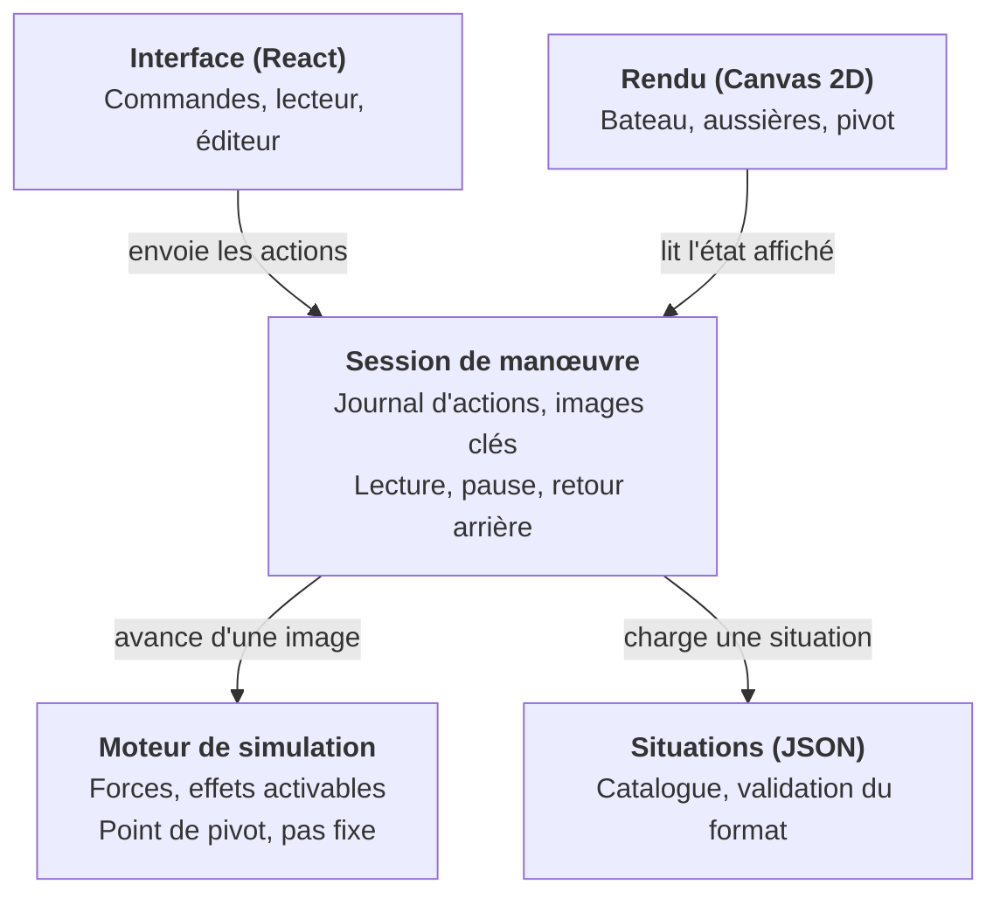

# Mini Cassiopée — Architecture technique

Ce document traduit les [spécifications](specifications.md) en choix techniques. Il est tenu à jour dans les demandes de fusion qui modifient l'architecture.

## Synthèse

Mini Cassiopée est une application web statique, sans serveur, écrite en TypeScript, dont le cœur est un moteur de simulation maison isolé de l'affichage.

- **Moteur de simulation maison**, en TypeScript pur, sans dépendance au navigateur : corps rigide 2D, pas de temps fixe, aussières en traction seule, contact simple avec le quai.
- **Effets physiques activables** : chaque enrichissement envisagé (pas d'hélice, bi-safran, fardage) est un module qu'on branche ou non, sans toucher au socle.
- **Relecture par journal d'actions et images clés**, qui rend le retour arrière fiable et peu gourmand en mémoire.
- **Situations décrites en JSON**, chargées par le catalogue et, à terme, produites par l'éditeur.
- **Rendu Canvas 2D**, interface en React, construction avec Vite.
- **Application web hébergée sur GitHub Pages** et déployée automatiquement par GitHub Actions ; installation sur téléphone et usage hors-ligne prévus.

Le code est publié sous licence MIT. Seule la licence des contenus pédagogiques reste ouverte, dans le registre des décisions en fin de document.

## Vue d'ensemble

L'application se découpe en cinq modules ; le moteur de simulation, au centre du projet, n'en connaît aucun autre.



Chaque flèche va d'un module vers ce dont il dépend. L'interface et le rendu ne touchent jamais directement au moteur : ils passent par la session, qui seule fait avancer la simulation et tient l'historique.

## Moteur de simulation

Le moteur est écrit sur mesure plutôt qu'adossé à une bibliothèque physique (Planck.js, Matter.js, Rapier). Environ 200 lignes suffisent, et un moteur maison garde la main sur ce qui compte ici : aussières en traction seule, résistance latérale répartie qui place le pivot, contact avec le quai servant de point d'appui.

### Repères et unités

- Unités SI : mètres, secondes, newtons, radians. L'interface convertit (degrés, nœuds) à l'affichage.
- Repère monde : x le long du quai, y vers le quai, bord du quai en y = 0.
- Repère bateau : x vers l'avant, y vers bâbord. Cap 0 : étrave vers +x.

### Modèle

- Corps rigide plan à trois degrés de liberté (x, y, cap), masses différentes en longitudinal et en latéral pour tenir compte de l'eau entraînée.
- Intégration d'Euler semi-implicite à pas fixe de 1/240 s, quatre sous-pas par image de 1/60 s. Le pas ne dépend jamais de la fréquence d'affichage.
- Forces du socle : moteur, safran (flux d'hélice en marche avant et erre), résistances longitudinale et latérale, vent au centre, aussières, contact et frottement sur le quai et le catway, contact avec les voisins.
- Catway : l'état porte un champ `catway`, nul le long du quai. C'est un rectangle immobile accroché au bord du quai, qui descend dans l'eau (y < 0) sur une longueur fixe, à une abscisse donnée. L'effet `catwayContact` le traite comme le quai : il repousse les points de la coque entrés dans le rectangle selon le flanc ou le bout le plus proche, et la coque là où un angle du bout du catway y est entré. Ses points d'appui rejoignent ceux du quai (`contacts`). Sans catway, l'effet n'ajoute rien.
- Bateaux voisins : l'état porte une liste `neighbors` de coques identiques et immobiles (position et cap fixes). L'effet `neighborContact` les traite comme le quai : ressort amorti qui ne tire jamais, plus frottement, appliqué à chaque point de la coque entré dans un voisin et, en sens inverse, là où un point d'un voisin est entré dans la coque (un angle de tableau contre le flanc). La coque étant convexe, la pénétration se mesure sous l'arête la plus proche (`hullPenetration`, dans `src/sim/geometry.ts`). Les points touchés sont gardés par voisin pour l'affichage. Sans voisin, la liste est vide et l'effet n'ajoute rien : ce n'est pas un effet optionnel mais un élément de la scène, absent par défaut.
- Aussières : ressort amorti qui ne travaille qu'en traction. Chacune est bloquée ou choquée (`payingOut`). Choquée, elle file sans retenue : à chaque sous-pas, sa longueur rejoint la distance du taquet à la bitte dès que le bateau s'en éloigne, et ne raccourcit jamais. Ce n'est pas un effet optionnel mais un état de l'aussière, changé par une action de l'élève.
- Point de pivot calculé à chaque image : point de l'axe dont la vitesse latérale est nulle, lissé et masqué quand le bateau translate sans tourner.

### Effets activables

Chaque force est un **effet** (`src/sim/effects.ts`) : une fonction qui reçoit l'état et les paramètres, et ajoute une force et un moment. Le socle en active une liste fixe, dans un ordre fixe ; les enrichissements à venir ajouteront des effets optionnels, déclarés dans la situation :

| Effet | Principe |
| --- | --- |
| Pas d'hélice | Poussée latérale à l'arrière, surtout en marche arrière, sens selon la rotation de l'hélice |
| Bi-safran | Safrans hors du flux d'hélice : effet de barre seulement avec de l'erre |
| Fardage de l'étrave | Point d'application du vent avancé : le vent fait abattre l'avant |

### Paramètres

Les constantes physiques (poussée, efficacité de barre, résistances, vent, raideur des aussières) sont regroupées dans un seul jeu de paramètres (`src/sim/params.ts`), versionné avec le code. Un panneau de réglages, accessible en ajoutant `#reglages` à l'adresse de l'application, permet de les affiner.

## Historique et relecture

Une manœuvre est enregistrée comme une situation de départ plus un journal horodaté des actions de l'élève, complété d'images clés de l'état (`src/session/session.ts`). C'est ce qui permet pause, pas à pas et retour arrière sans conserver chaque image.

- **Journal d'actions** : chaque action (moteur, barre, largage, choquer ou bloquer une aussière) est notée avec le numéro d'image où elle s'applique.
- **Images clés** : l'état complet est sauvegardé toutes les 60 images (1 s). Pour afficher l'image n, on repart de l'image clé précédente et on resimule au plus 59 images, ce qui reste imperceptible.
- **Embranchement** : une action faite après un retour arrière efface la suite du journal et des images clés, puis la manœuvre repart de ce point.
- **Mémoire** : un état tient en moins de 200 octets ; un quart d'heure de manœuvre représente environ 900 images clés, soit moins de 200 ko.

La resimulation exige que le moteur soit déterministe sur un même appareil : pas de hasard, pas de dépendance à l'horloge, ordre de calcul fixe. Une relecture ne sort jamais de l'appareil, donc les écarts infimes de calcul entre navigateurs ne posent pas de problème.

## Format des situations

Chaque situation du catalogue est un fichier JSON lisible à la main, dans `src/situations/catalogue/`. Le moteur ne connaît que ce format, ce qui découple le catalogue, l'éditeur et une éventuelle fonction de partage future.

```json
{
  "format": 1,
  "id": "depart-garde-avant",
  "titre": "Départ sur garde avant",
  "description": "Seule la garde avant est tournée. Marche avant : l'étrave s'appuie sur le quai et l'arrière décolle.",
  "quai": { "type": "long-side" },
  "bateau": { "x": 0, "distanceQuai": 0.05, "bordAuQuai": "babord" },
  "aussieres": [
    { "id": "garde-av", "taquet": "etrave", "bitte": 0, "mou": 0 }
  ],
  "vent": { "direction": "quai", "force": "aucun" }
}
```

- `quai.type` vaut `long-side` ou `perpendiculaire`. En perpendiculaire, le bateau est amarré le long d'un catway, long des 2/3 du bateau (`LONGUEUR_CATWAY`) ; on appelle **support** le bord le long duquel il est amarré : le quai le long du quai, le catway en perpendiculaire.
- `bateau.x` est la position du centre du bateau le long du support. Le long du quai, c'est l'abscisse monde. En perpendiculaire, c'est la distance au bord du quai, comptée le long du catway vers le chenal ; le bout du bateau côté quai doit en rester à 0,5 m au moins (`ECART_QUAI_MIN`).
- `bateau.distanceQuai` est l'écart entre le flanc et le support : le bord du quai, ou le flanc du catway.
- `bordAuQuai` vaut `babord` ou `tribord` : le flanc tourné vers le support.
- `bateau.boutAuQuai`, en perpendiculaire seulement et obligatoire, vaut `etrave` ou `arriere`.
- `taquet` vaut `etrave`, `arriere` (côté quai), `arriere-large` ou `maitre-bau`. L'éditeur propose `etrave`, `arriere` et `arriere-large`.
- `bitte` est la position de la bitte le long du support, en mètres, depuis le centre du bateau au départ, positive vers l'avant. Elle doit tomber sur la rangée de bittes du support : sa position le long du support (`bateau.x` plus ou moins `bitte` selon le sens de l'étrave) est un multiple de l'espacement, 2 m (`BOLLARD_SPACING` dans `src/situations/quai.ts`, avec les conversions entre position relative et position le long du support). La rangée du catway part du bord du quai et s'arrête au bout du catway.
- `sur` est facultatif, en perpendiculaire seulement : `quai` pour une bitte de la rangée du quai. `bitte` est alors sa position le long du quai depuis l'axe du bateau, positive vers le catway, et sa position monde doit être un multiple de 2 m. Absent, la bitte est sur le support.
- Deux aussières ne peuvent pas relier le même taquet à la même bitte.
- `nom` est facultatif : absent, il est déduit de la géométrie au départ (voir l'édition ci-dessous) ; présent, c'est le nom choisi par l'auteur ou l'élève.
- `mou` vaut 0 pour une aussière tendue au départ, ou la longueur de mou en mètres. L'éditeur ne produit que 0 (tendue) ou 0,5 (molle) ; le catalogue peut utiliser d'autres valeurs.
- `file` est facultatif : `true` pour une aussière choquée dès la mise en mouvement ; absent, elle est bloquée. Le validateur ne garde que `true`.
- `plafondAussieres` est facultatif : nombre maximal d'aussières de la situation, entier de 6 à 12, 6 par défaut, jamais inférieur au nombre d'aussières déclarées.
- `voisins` est facultatif, le long du quai seulement : `{ "avant": écart, "arriere": écart }`, chaque côté facultatif. L'écart, en mètres de 0,5 à 20, sépare l'étrave (ou le tableau arrière) du bateau au départ de l'extrémité du voisin. Le voisin a la même coque, le même cap et le même écart au quai que le bateau (`xVoisin` dans `src/situations/quai.ts`). Un objet vide ne déclare aucun voisin.
- `vent.direction`, le long du quai, vaut `quai`, `large`, `avant`, `arriere` ou une combinaison (`quai-avant`, `large-arriere`…) ; `avant` et `arriere` se rapportent au cap du bateau au départ. En perpendiculaire, elle vaut `catway`, `large` (côté opposé au catway), `quai`, `chenal` ou une combinaison (`catway-quai`, `large-chenal`…). `vent.force` vaut `aucun`, `faible` ou `soutenu`.
- `format` permet de faire évoluer le schéma en gardant la lecture des anciennes situations.

```json
{
  "quai": { "type": "perpendiculaire" },
  "bateau": { "x": 6, "distanceQuai": 0.3, "bordAuQuai": "babord", "boutAuQuai": "etrave" },
  "aussieres": [
    { "id": "pointe-av", "taquet": "etrave", "sur": "quai", "bitte": 0.5, "mou": 0 },
    { "id": "garde-av", "taquet": "etrave", "bitte": 2, "mou": 0 }
  ],
  "vent": { "direction": "catway", "force": "faible" }
}
```

Évolutions prévues : `quai` accueillera `longueurCatway` (#29), et `voisins` les côtés propres au catway (#30) ; les effets avancés s'ajouteront sous `options`.

Une fonction de validation (`src/situations/schema.ts`) accompagne le format ; une situation invalide est refusée au chargement avec un message lisible. Les nouvelles règles (bitte sur la rangée, doublons, plafond, nom facultatif, voisins, catway) restent compatibles avec le format 1 : seul le catalogue existant est recalé sur la rangée de bittes.

La géométrie du port est regroupée dans `src/situations/quai.ts` : sens de l'étrave le long du support (`bowSign`), position monde d'une bitte (`pointBitte`), bittes à dessiner (`bittesDuPort`), bitte touchée dans l'éditeur (`bitteDepuisPoint`), et position d'une bitte dans le repère du bateau tourné vers le support (`bitteRepereBateau`), qui sert au nom déduit. Le catway a son axe en x = 0 ; le bateau est placé d'un côté ou de l'autre selon le bord au catway et le bout au quai.

### Édition de la situation

L'éditeur produit des situations au même format que le catalogue. Les opérations sont des fonctions pures sur une `Situation` (`src/situations/edit.ts`), sans dépendance au navigateur et testables seules :

- `ajouterAussiere(situation, taquet, bitte, sur)`, refusée avec un message lisible en cas de doublon ou de plafond atteint ;
- `supprimerAussiere`, `basculerMou` (tendue ou 0,5 m de mou), `basculerFile` (bloquée ou choquée au départ), `renommerAussiere`, `reglerPlafond` ;
- `nomDeduit(situation, aussiere)` : traversier si l'aussière fait moins de 20° avec la perpendiculaire au bateau, sinon pointe ou garde selon que la bitte est en dehors ou en dedans du taquet le long du bateau, avant ou arrière selon le taquet. Le calcul se fait en repère bateau, ce qui le rend indépendant du bord au quai ; en perpendiculaire, il s'applique tel quel aux bittes du catway comme à celles du quai. `nomsAffiches(situation)` garde les noms choisis ; il départage les noms déduits identiques par leur bord (`bordAussiere` : celui du taquet, ou pour l'étrave celui de la bitte) quand chacun est sur un bord différent, et sinon les numérote ; `buildState` l'utilise pour nommer les aussières de la simulation ;
- `taquetsProposes(situation)` : les taquets offerts à l'éditeur et leur position, selon le bord au quai ;
- `deplacerBateau(situation, origine, x)` : place le bateau en `x` le long du support, arrondi au pas de 0,5 m (`PAS_DEPLACEMENT`) et borné à 4 m (`DEPLACEMENT_MAX`) autour de la position de la situation d'origine, à 0,5 m au moins de chaque voisin et, en perpendiculaire, du quai (`bornesDeplacement`, qui sert aussi aux boutons ◀ ▶ ou ▲ ▼). Les aussières tournées sur le quai en perpendiculaire gardent leur `bitte`, l'axe du bateau ne bougeant pas le long du quai. Les aussières gardent leur bitte dans le repère monde : leur `bitte` relative est recalculée, et la longueur et le nom déduit suivent à la construction de l'état. Les voisins restent eux aussi en place : leur écart est recalculé. La fonction renvoie la même situation quand la position ne change pas, ce qui évite une session inutile pendant un glisser.
- `reglerVoisin(situation, origine, cote, ecart)` : place un voisin devant ou derrière, ou le retire (`null`) ; refusé en perpendiculaire. L'éditeur propose serré (1 m) et large (3 m), comptés depuis la place d'origine du bateau, si bien que le choix affiché (`ecartVoisin`) ne change pas quand on fait glisser le bateau. Refusé avec un message lisible si le bateau déplacé est à moins de 0,5 m de cette place.

L'interface conserve deux situations : la **situation d'origine** issue du catalogue et la **situation préparée** qu'elle modifie. Chaque modification, faite à l'image 0, crée une nouvelle session à partir de la situation préparée, comme le changement de vent aujourd'hui ; la session et le moteur ne changent pas. « ⏮ » revient à l'image 0 de cette session, le bouton « Situation d'origine » recopie la situation d'origine dans la situation préparée. Rien n'est stocké d'une visite à l'autre.

## Rendu et interface

La scène est dessinée en Canvas 2D par un module impératif (`src/render`) ; les commandes autour sont des composants React (`src/ui`). Les deux ne se parlent qu'à travers la session.

- **Canvas 2D** : un seul bateau et une dizaine de traits, à 60 images par seconde même sur un téléphone d'entrée de gamme. Pas besoin de WebGL ni de SVG.
- **Rendu sans état** : le dessin est une fonction de l'état affiché et des préférences d'affichage. Il ne modifie jamais la simulation.
- **Voisins** : coques estompées sous le bateau. Pendant un contact, le contour du voisin et un anneau sur chaque point touché prennent la couleur d'alerte (`--alert`) ; l'anneau garde le signal visible sans la couleur.
- **Catway** : rectangle de la couleur du quai, sous le bateau, avec sa rangée de bittes sur l'axe. Les bittes à dessiner, du quai et du catway, sont fournies au rendu comme une préférence d'affichage.
- **Caméra** : quai en haut de l'écran, bateau suivi quand il s'éloigne. En perpendiculaire, le bateau et le catway sont verticaux sous le quai ; les 17 m de hauteur de vue les montrent entiers. Sur téléphone, un cadrage plus serré ; le zoom à deux doigts est prévu, car le bateau paraît petit sur un téléphone.
- **Bittes et taquets** : la rangée de bittes est dessinée sur toute la partie visible du quai. En préparation, les taquets proposés et les bittes deviennent des cibles tactiles d'au moins 44 px, plus larges que leur dessin ; le taquet sélectionné et les bittes disponibles sont mis en évidence. Le rendu reçoit cette sélection comme une préférence d'affichage et reste sans état.
- **Glisser le bateau** : en préparation, la scène tranche le geste au relâcher. Si le doigt a bougé de moins de 8 px, c'est un toucher sur la cible la plus proche ; au-delà, un geste commencé sur la coque ou un taquet déplace le bateau. Le déplacement est mesuré depuis le début du geste et converti en mètres, projeté sur la direction du support (horizontale le long du quai, verticale le long du catway), puis l'interface appelle `deplacerBateau` avec la position visée : des événements rapprochés ne font pas dériver le bateau.
- **Couleurs** : tirées des variables CSS du thème, clair et sombre.
- **Disposition** : scène et commandes côte à côte sur PC et tablette en paysage ; scène en haut et commandes dessous sur téléphone, avec les commandes de manœuvre (moteur, barre, largage) accessibles au pouce sans défilement.
- **Liste des aussières** : chaque ligne montre le nom et l'état (tendue, molle, file, larguée), puis sur une seconde rangée les boutons « Choquer », à bascule, et « Larguer » (« Supprimer » en préparation).
- **Clavier** sur PC : raccourcis pour la lecture, le moteur, la barre, le largage (chiffre), le choquer (Maj + chiffre), le pas à pas et, en préparation, le déplacement du bateau (Maj + flèches gauche et droite le long du quai, haut et bas le long du catway), rappelés en bas du panneau de commandes. Les chiffres sont repérés par la touche et non par le caractère, pour fonctionner pareil en AZERTY et en QWERTY.
- **Accessibilité** : commandes utilisables au clavier, contrastes suffisants dans les deux thèmes, état des aussières indiqué par la couleur et par un libellé.

## Stack, outillage et organisation du code

La stack reste courte et courante, pour que le projet soit facile à reprendre par d'autres.

| Rôle | Choix | Raison |
| --- | --- | --- |
| Langage | TypeScript | Typage du modèle et du format des situations |
| Interface | React | Stack déjà maîtrisée ; le panneau de commandes reste petit |
| Construction | Vite | Démarrage rapide, sortie statique, extension PWA disponible |
| Tests | Lanceur de tests de Node.js | Aucune dépendance, tests du moteur sans navigateur ni installation |
| Validation des situations | Validation écrite à la main | Format petit : messages d'erreur lisibles sans dépendance |
| Hors-ligne | vite-plugin-pwa (à venir) | Manifeste et service worker générés |

Aucune autre dépendance d'exécution n'est prévue. Le poste de développement n'a besoin que de Node.js 22.18 ou plus récent et de Git, installables sans droits d'administrateur sous Windows (archive Node.js décompressée dans le dossier utilisateur, Git en version portable).

```text
mini-cassiopee/
  src/
    sim/          moteur : modèle, effets, intégration, pivot (aucune dépendance au navigateur)
    session/      journal d'actions, images clés, lecture
    situations/   format JSON, validation, catalogue
    render/       dessin Canvas et caméra
    ui/           composants React : commandes, lecteur, éditeur
  tests/          scénarios de référence
  docs/           spécifications et architecture
```

La règle de dépendance est stricte : `sim` ne dépend de rien, `session` dépend de `sim`, `render` et `ui` dépendent de `session`. Le moteur reste ainsi testable seul et réutilisable.

## Hors-ligne, hébergement et licence

L'application est un ensemble de fichiers statiques, destiné à être installable sur l'écran d'accueil et utilisable sans réseau après une première visite.

### Hors-ligne (à venir)

- Manifeste d'application web : nom, icônes, affichage plein écran, orientation libre.
- Service worker qui met en cache tous les fichiers à la première visite, puis les sert sans réseau. Une nouvelle version est récupérée en arrière-plan et proposée au lancement suivant.
- Stockage local du navigateur pour les préférences (affichage, dernière situation ouverte). Rien d'indispensable n'y est stocké.

### Hébergement et déploiement

Le dépôt et l'application sont hébergés sur GitHub : le code dans un dépôt public, l'application sur GitHub Pages (<https://jppouzol.github.io/mini-cassiopee/>), gratuitement. Le workflow `.github/workflows/ci.yml` lance les tests, la vérification des types et la construction à chaque demande de fusion, puis déploie l'application à chaque fusion dans `main`.

Codeberg a été écarté comme hébergement principal parce que l'environnement de développement assisté n'y a pas accès, ce qui obligerait à transférer chaque livraison à la main. Un miroir Codeberg reste possible à tout moment ; le projet ne contient ni données personnelles ni comptes, l'enjeu de souveraineté est donc faible.

### Licence

Licence MIT pour le code. Pour les situations du catalogue et les textes pédagogiques, CC0 reste proposée afin qu'un club puisse les reprendre sans formalité.

## Tests et qualité

La physique se teste par comportements attendus, pas par valeurs exactes : un réglage des paramètres ne doit pas casser un test, un changement de comportement si.

| Scénario de référence | Comportement vérifié |
| --- | --- |
| Repos, sans vent | Le bateau ne bouge pas |
| Garde avant, marche avant | L'étrave reste en appui, le pivot passe à l'avant, l'arrière s'écarte du quai |
| Garde avant, avec barre côté quai | Le pivot est plus rapide que sans barre |
| Garde avant, phase 2 | Moteur arrière et garde larguée : le bateau se dégage sans toucher le quai |
| Garde arrière, marche arrière | Le pivot passe à l'arrière, l'étrave s'écarte |
| Quatre amarres, vent soutenu du quai | Le bateau se déplace de moins de 20 cm |
| Quatre amarres, vent du large | Le bateau est plaqué contre le quai, les aussières sont molles |
| Aucune amarre, vent du quai | Le bateau dérive vers le large |
| Tribord au quai | Le départ sur garde avant est le symétrique exact |
| Relecture | Revenir à une image puis la rejouer redonne exactement le même état |
| Nom déduit | Pointe, garde et traversier, avant et arrière, reconnus d'après la géométrie ; résultat identique tribord au quai |
| Édition des aussières | Ajout et suppression ; doublon et dépassement du plafond refusés ; plafond borné entre 6 et 12 et jamais sous le nombre d'aussières |
| Aussière ajoutée | Une garde avant ajoutée dans l'éditeur sur une situation sans amarre se comporte comme celle du catalogue |
| Déplacement du bateau | Bittes inchangées dans le repère monde, bâbord comme tribord au quai ; pas de 0,5 m et bornes de ±4 m ; une garde devient traversier, un nom choisi est gardé ; traversier arrière possible bateau décalé de 1 m |
| Rangée périodique | Bateau et aussières décalés de 2 m : la manœuvre est identique, à la translation près |
| Choquer | Garde avant choquée en marche avant : le bateau avance sans être retenu ; bloquée, elle le retient de nouveau ; une aussière molle choquée ne change rien |
| Choquer au départ | Une aussière qui file dès le départ équivaut à une aussière choquée à la première image |
| Voisins sans contact | Des voisins qu'on ne touche pas ne changent rien à la manœuvre |
| Voisin en obstacle | Marche avant ou arrière sans amarre : le voisin arrête le bateau, sans pénétration notable, et le contact est signalé ; symétrique tribord au quai |
| Voisin en appui | Étrave contre le voisin et barre : le bateau pivote autour de l'étrave |
| Garde avant entre deux voisins | Sans garde, barre vers le large, l'étrave touche le voisin ; sur la garde, le bateau sort sans contact |
| Édition des voisins | Placer, changer, retirer ; voisins fixes quand on glisse le bateau, qui s'arrête à 0,5 m ; voisin refusé faute de place |
| Relecture d'un contact | Un contact avec un voisin se rejoue à l'identique |
| Relecture du choquer | Choquer puis bloquer se rejoue à l'identique ; basculer en pause après un retour arrière équivaut à basculer en lecture à la même image |
| Format du catway | Bout au quai obligatoire, bitte hors de la rangée ou au-delà du bout du catway refusée, bout du bateau trop près du quai refusé, voisins et directions de vent du long du quai refusés |
| Catway en obstacle | Sans amarre, vent du large : le bateau vient sur le catway et s'y arrête sans pénétration notable, contact signalé ; symétrique de l'autre côté |
| Quai en bout | Étrave au quai sans amarre, marche avant : le quai arrête l'étrave |
| Catway, vérification d'amarrage | Vent soutenu du catway : l'amarrage tient, l'avant qui dépasse bouge plus que l'arrière |
| Sortie en marche arrière | Étrave au quai, aussières larguées : le bateau recule le long du catway sans le toucher |
| Sortie en marche avant | Arrière au quai, aussières larguées : le bateau sort vers le chenal sans toucher le catway |
| Nom déduit sur catway | Pointe avant vers le quai, gardes et traversier sur le catway ; identique de l'autre côté du catway |
| Nom par bord | Deux pointes arrière, une par taquet arrière, nommées bâbord et tribord, le long du quai comme sur catway ; deux pointes avant depuis l'étrave, nommées d'après le bord de leur bitte ; numéro si le bord ne suffit pas |
| Déplacement le long du catway | Arrêt à 0,5 m du quai ; bittes du catway inchangées en monde, bittes du quai inchangées |
| Relecture d'un contact au catway | Un appui sur le catway se rejoue à l'identique |

S'y ajoutent des tests de stabilité numérique (aucune valeur non finie, pas d'oscillation résiduelle) et des tests du format des situations, dont le placement des bittes du catalogue sur la rangée. Le reste de l'interface se vérifie à la main sur PC, Android et iOS avant chaque version.

## Registre des décisions

Chaque choix structurant est noté ici avec son statut ; une décision ne change qu'en mettant à jour cette ligne.

| Décision | Choix | Statut |
| --- | --- | --- |
| Application sans serveur | Fichiers statiques, tout dans le navigateur | Décidé |
| Moteur physique | Moteur maison | Décidé |
| Relecture | Journal d'actions et images clés toutes les secondes | Décidé |
| Stack | TypeScript, React, Vite ; tests avec le lanceur intégré à Node.js | Décidé |
| Rendu | Canvas 2D | Décidé |
| Format des situations | JSON versionné, validation écrite à la main | Décidé |
| Points d'amarrage | Rangée de bittes fixes espacées de 2 m ; catalogue recalé dessus | Décidé |
| Édition des aussières | En préparation seulement, par fonctions pures sur la situation ; situation préparée distincte de la situation d'origine ; plafond de 6, réglable jusqu'à 12 | Décidé |
| Déplacement du bateau | En préparation, au doigt ou pas à pas, par pas de 0,5 m et à ±4 m de l'origine ; les aussières restent sur leurs bittes | Décidé |
| Choquer une aussière | Bouton à bascule toujours disponible, en préparation comme en lecture et en pause ; l'aussière file sans retenue et sans limite de longueur ; état de l'aussière, pas un effet optionnel ; reprise, freinage et longueur finie traités à part | Décidé |
| Bateaux voisins | Le long du quai, devant et derrière, réglés à part (aucun, serré, large) dans les options avancées ; coques identiques et immobiles ; contact simple comme le quai, pouvant servir d'appui ; contact signalé par le contour du voisin et un anneau rouges ; voisins fixes quand on glisse le bateau, qui s'arrête à 0,5 m | Décidé |
| Amarrage perpendiculaire | Catway de longueur fixe (2/3 du bateau), étrave ou arrière au quai selon la situation ; rangée de bittes tous les 2 m sur le catway, rangée du quai conservée ; contact comme le quai ; nommage inchangé ; vent en repères du port (catway, large, quai, chenal) ; type d'amarrage fixé par le catalogue ; bateau déplaçable le long du catway jusqu'à 0,5 m du quai ; ni longueur réglable (#29) ni voisins (#30) | Décidé |
| Taquets proposés | Étrave et arrière des deux bords, partout ; deux aussières de même nom départagées par le bord, sinon par un numéro | Décidé |
| Hébergement | Dépôt public et GitHub Pages | Décidé |
| Déploiement | GitHub Actions : tests sur chaque proposition, déploiement à chaque fusion | Décidé |
| Licence du code | MIT | Décidé |
| Licence des contenus | CC0 proposée pour les situations et textes pédagogiques | Ouvert |
| Pilotage des évolutions | Pas de paliers ni de jalons ; backlog dans les issues GitHub, une issue par évolution | Décidé |
| Documentation de référence | `docs/` dans le dépôt fait foi, mise à jour avec le code | Décidé |
