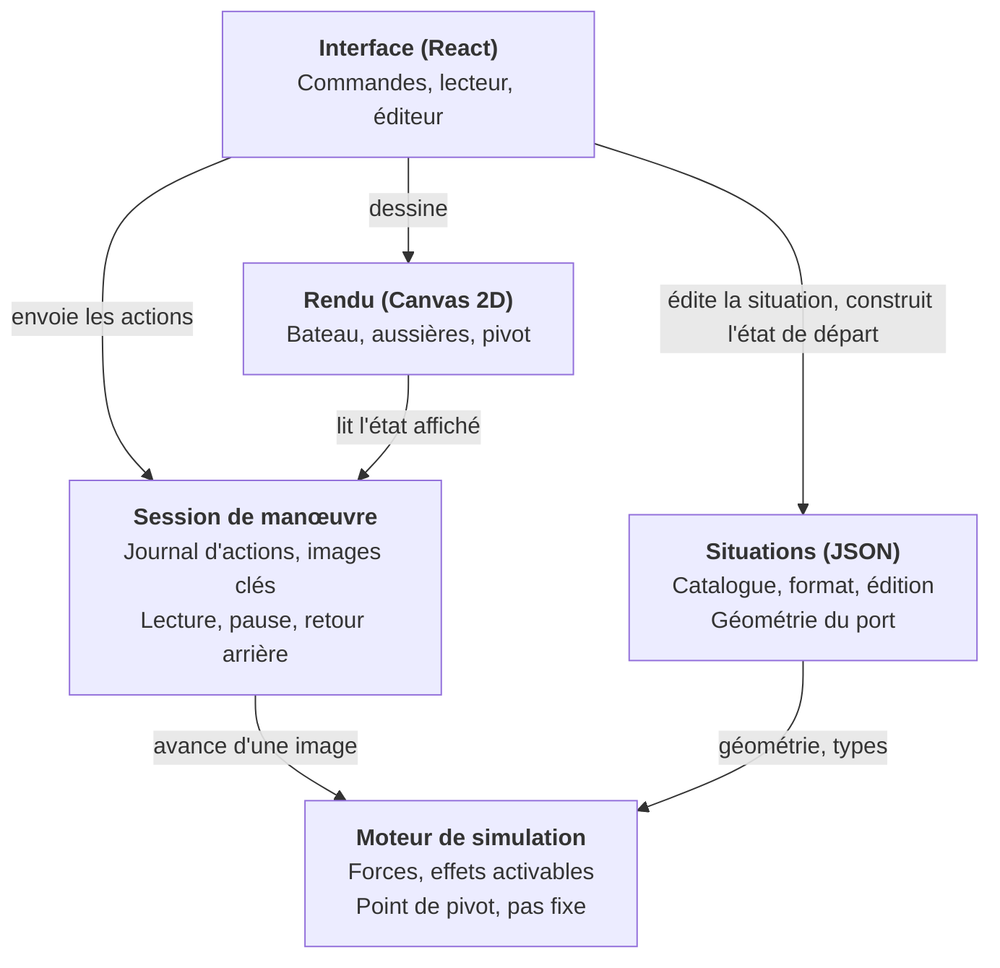

# Mini Cassiopée — Architecture technique

Ce document traduit les [spécifications](specifications.md) en choix techniques. Il est tenu à jour dans les demandes de fusion qui modifient l'architecture.

## Synthèse

Mini Cassiopée est une application web statique, sans serveur, écrite en TypeScript, dont le cœur est un moteur de simulation maison isolé de l'affichage.

- **Moteur de simulation maison**, en TypeScript pur, sans dépendance au navigateur : corps rigide 2D, pas de temps fixe, aussières en traction seule, contact simple avec le quai.
- **Effets physiques activables** : chaque enrichissement (pas d'hélice, fardage, puis bi-safran) est un module qu'on branche ou non, sans toucher au socle.
- **Relecture par journal d'actions et images clés**, qui rend le retour arrière fiable et peu gourmand en mémoire.
- **Situations décrites en JSON**, chargées par le catalogue et produites par l'éditeur.
- **Rendu Canvas 2D**, interface en React, construction avec Vite.
- **Application web hébergée sur GitHub Pages** et déployée automatiquement par GitHub Actions ; installable sur l'écran d'accueil et utilisable hors ligne grâce à un service worker écrit à la main.

Le code est publié sous licence MIT. Seule la licence des contenus pédagogiques reste ouverte, dans le registre des décisions en fin de document.

## Vue d'ensemble

L'application se découpe en cinq modules, plus le hors-ligne (`src/pwa`), à part ; le moteur de simulation, au centre du projet, n'en connaît aucun autre.



Chaque flèche va d'un module vers ce dont il dépend. La session seule fait avancer la simulation (`tick`), modifie l'état et tient l'historique : l'interface lui envoie les actions de l'élève et lui confie l'état de départ, construit à partir de la situation préparée (`buildState`) ; le rendu lit l'état qu'elle affiche. Les autres modules n'empruntent au moteur que ses types, sa géométrie (coque, taquets, rangée d'en face) et ses constantes, des fonctions pures qu'ils ne font jamais avancer.

## Moteur de simulation

Le moteur est écrit sur mesure plutôt qu'adossé à une bibliothèque physique (Planck.js, Matter.js, Rapier). Il tient en un millier de lignes, et un moteur maison garde la main sur ce qui compte ici : aussières en traction seule, résistance latérale répartie qui place le pivot, contact avec le quai servant de point d'appui.

### Repères et unités

- Unités SI : mètres, secondes, newtons, radians. L'interface convertit (degrés, nœuds) à l'affichage.
- Repère monde : x le long du quai, y vers le quai, bord du quai en y = 0. En situation libre, le bateau part de l'origine, étrave vers +y (le haut de l'écran), et y = 0 n'est le bord de rien.
- Repère bateau : x vers l'avant, y vers bâbord. Cap 0 : étrave vers +x.

### Modèle

- Corps rigide plan à trois degrés de liberté (x, y, cap), masses différentes en longitudinal et en latéral pour tenir compte de l'eau entraînée.
- Intégration d'Euler semi-implicite à pas fixe de 1/240 s, quatre sous-pas par image de 1/60 s. Le pas ne dépend jamais de la fréquence d'affichage.
- Forces du socle : moteur, safran, résistances longitudinale et latérale, portance de la quille, vent au centre, aussières, contact et frottement sur le quai et le catway, contact avec les voisins.
- Safran : traité comme un aileron, dont l'incidence a deux causes. La barre, avec le flux d'hélice en marche avant (vitesse déduite de son effet, `washSpeed`) et l'erre, signée : en marche arrière, la barre agit dans l'autre sens. Et l'eau qui arrive de côté quand l'arrière dérape (`v + w · xRudder`) : le safran s'y oppose d'autant plus que l'eau passe vite (`rudderGrip`), ce qui freine le dérapage et resserre la giration.
- Quille : en route, elle s'oppose au dérapage en proportion de la vitesse longitudinale (`keelLift`), comme une aile. Son centre de poussée se porte vers l'extrémité qui ouvre la route (`keelShift`) : c'est ce qui place le pivot dans la moitié avant en marche avant et dans la moitié arrière en marche arrière. Bateau arrêté, elle ne porte pas.
- Résistance latérale : répartie en tranches le long de la coque, concentrée vers le milieu où la quille et le tirant d'eau la portent (`dragYCenter`, `sliceWeights`), et faible aux extrémités. Son total ne dépend pas de cette répartition : la dérive au vent du bateau arrêté non plus.
- Quai : l'état porte un booléen `quay`, faux en situation libre seulement. L'effet `quayContact` n'ajoute alors rien et vide la liste des appuis : ce n'est pas un effet optionnel mais un élément de la scène, présent par défaut.
- Catways : l'état porte une liste `catways`, vide le long du quai : le catway du bateau et le second, côté large. Chacun est un rectangle immobile accroché par son pied (`y`) au bord du quai ou de la panne d'en face, qui s'avance dans l'eau dans un sens (`dir` : -1 vers le bas depuis le quai, 1 vers le haut depuis la panne d'en face) sur une longueur fixe, à une abscisse donnée. L'effet `catwayContact` les traite comme le quai : il repousse les points de la coque entrés dans un rectangle selon le flanc ou le bout le plus proche, et la coque là où un angle du bout d'un catway y est entré ; le pied n'est pas une sortie, le quai ou la panne ayant leur propre contact. Ses points d'appui rejoignent ceux du quai (`contacts`). Sans catway, l'effet n'ajoute rien.
- Rangée d'en face : l'état porte `enFace` (`RangeeEnFace`), null sans bateaux en face. La rangée est périodique et sans fin le long du quai : une panne (bande de `yPanne` à `yPanne` − `largeurPanne`), des catways qui en montent tous les `pas` mètres depuis `x0`, et un bateau immobile de chaque côté de chacun, à `recul` de son axe, en `yBateaux`, cap `th`. L'état n'en garde que ces nombres ; `src/sim/enface.ts` en tire les catways (`catwaysEnFace`) et les bateaux (`bateauxEnFace`) compris entre deux abscisses. Les effets ne calculent que ceux qui sont proches du bateau : `catwayContact` y ajoute les catways d'en face et la panne, sans angle puisqu'elle est sans fin ; `neighborContact` traite les bateaux d'en face comme les voisins et note dans `enFace.contacts` l'abscisse de chaque bateau touché et ses points de contact, pour l'affichage. Une image clé reste ainsi petite, quelle que soit la longueur de l'allée parcourue.
- Bateaux voisins : l'état porte une liste `neighbors` de coques identiques et immobiles (position et cap fixes). L'effet `neighborContact` les traite comme le quai : ressort amorti qui ne tire jamais, plus frottement, appliqué à chaque point de la coque entré dans un voisin et, en sens inverse, là où un point d'un voisin est entré dans la coque (un angle de tableau contre le flanc). La coque étant convexe, la pénétration se mesure sous l'arête la plus proche (`hullPenetration`, dans `src/sim/geometry.ts`). Les points touchés sont gardés par voisin pour l'affichage. Sans voisin, la liste est vide et l'effet n'ajoute rien : ce n'est pas un effet optionnel mais un élément de la scène, absent par défaut. Les bateaux d'en face reçoivent le même contact (`hullContact`) et le même signalement, sans être dans la liste (voir la rangée d'en face).
- Aussières : ressort amorti qui ne travaille qu'en traction. Chacune a un mode (`mode`, type `LineMode`) : `bloque` (par défaut), `choque` ou `reprend`. Choquée, sa longueur rejoint à chaque sous-pas la distance du taquet à la bitte dès que le bateau s'en éloigne, sans jamais raccourcir. Reprise (#22), elle raccourcit de `haulSpeed` par seconde tant que la tension du sous-pas précédent reste sous `crewEffort`, sans descendre sous `lineMinLen`. L'équipier ressent la tension lissée sur `crewHold` (champ `load`), qui lui fait encaisser l'à-coup du mou rattrapé ; quand elle dépasse `crewEffort` de plus de `crewMargin`, le mode passe de lui-même à `choque`, dans la simulation, ce qui garde la relecture exacte. Après chaque image, `tick` note dans `rate` la variation de longueur (m/s), que lit l'affichage. C'est un état de l'aussière, changé par une action de l'élève ou par le lâcher, pas un effet optionnel.
- Moteur et ralenti : `engine` vaut -1 (marche arrière), -0,5 (ralenti arrière), 0 (neutre), 0,5 (ralenti avant) ou 1 (marche avant), dans cet ordre (`ENGINE_POSITIONS`). Son signe donne le sens de la poussée ; au ralenti, `thrustOf` la multiplie par `idleFactor` (0,5), et le flux d'hélice au safran (`washSpeed`) et le pas d'hélice suivent, comme pour le coup de fouet. Ce n'est pas un effet optionnel mais une position de la commande : en marche, le facteur vaut 1 et rien ne change.
- Coup de fouet : état du moteur (`kick`, nul hors d'un coup), pas un effet optionnel (`src/sim/kick.ts`). Pendant un coup, `thrustOf` donne le sens du coup et le facteur `kickFactor`, que suivent le flux d'hélice au safran et le pas d'hélice ; `engine` garde la position où le moteur reviendra. `startKick`, appliqué par l'action de l'élève sans les paramètres, choisit la règle : durée `kickTime`, ou, à contre-sens de `engine`, retour au neutre et arrêt dès que la vitesse longitudinale ne va plus dans l'ancien sens, au plus tard après `kickMaxTime` (durée fixe si l'erre est déjà sous `KICK_ERRE_MIN`). `updateKick`, appelé par `tick` à chaque image, compte les images écoulées, ce qui garde la relecture exacte. Une action moteur annule le coup ; un nouveau coup le remplace.
- Point de pivot calculé à chaque image : point de l'axe dont la vitesse latérale est nulle, lissé et masqué quand le bateau translate sans tourner. Le moteur le borne à la coque, de l'étrave à l'arrière (`updatePivot`) ; le montrer hors de la coque est une option envisagée (#45).

### Effets activables

Chaque force est un **effet** (`src/sim/effects.ts`) : une fonction qui reçoit l'état et les paramètres, et ajoute une force et un moment. Le socle en active une liste fixe, dans un ordre fixe. Les effets optionnels sont déclarés dans la situation, sous `options`, et recopiés dans l'état (`options`, fixé pour toute la manœuvre et conservé dans les images clés). `activeEffects(state)` renvoie le socle suivi des effets optionnels activés, toujours dans le même ordre ; c'est la liste qu'utilise `tick` par défaut. Sans option, c'est exactement la liste du socle : le comportement de base ne change pas.

| Effet | Principe | Statut |
| --- | --- | --- |
| Pas d'hélice (`propWalk`) | Poussée latérale à l'hélice (`xProp`) quand le moteur tourne. Hélice à droite (`options.propWalk = 'droite'`), l'arrière part vers bâbord en marche arrière (`propWalkRev`) ; en marche avant, effet plus faible et de sens contraire (`propWalkFwd`). Hélice à gauche, tout s'inverse. La poussée est divisée par 1 + (u / `propWalkSpeed`)² : maximale bateau arrêté, elle faiblit avec l'erre, si bien que la barre reprend le dessus. Au ralenti, elle est multipliée par `idleFactor`, pendant un coup de fouet par `kickFactor`, comme la poussée | Livré |
| Bi-safran | Safrans hors du flux d'hélice (`washSpeed` nulle) : effet de barre et tenue au dérapage seulement avec de l'erre | Envisagé |
| Fardage (`windage`) | Le vent, appliqué au centre par le socle, reçoit un moment : sa force latérale s'applique en `windageX` + `windageShift` × cos β le long de l'axe, β étant l'angle d'où vient le vent compté depuis l'étrave. Le point se porte vers le bout qui reçoit le vent : l'équilibre étrave au vent devient instable et le bateau arrêté finit à peu près en travers. Vent dans l'axe, rien ne brise la symétrie : l'effet ajoute le moment d'un vent arrivant de `windageSkew` sur le côté tiré (`options.windage`, 1 : l'avant abat vers bâbord, -1 vers tribord), pondéré par cos² β pour s'effacer par le travers. Le côté est tiré au hasard par l'interface à chaque nouvelle session (`buildState(situation, vent, abattee)`), noté dans l'état initial et rejoué à l'identique ; le moteur, lui, reste sans hasard | Livré |

### Paramètres

Les constantes physiques (poussée, efficacité de barre, résistances, vent, raideur des aussières) sont regroupées dans un seul jeu de paramètres (`src/sim/params.ts`), versionné avec le code. Un panneau de réglages, accessible en ajoutant `#reglages` à l'adresse de l'application, permet de les affiner. Un changement de réglage efface la suite de la manœuvre enregistrée, qui reprend avec les nouveaux paramètres depuis l'image affichée (`setParams`). Limite connue : revenir ensuite plus tôt recalcule les images situées entre deux images clés avec les nouveaux paramètres, si bien que le passé change par morceaux d'une seconde ; seul ce panneau de mise au point est concerné.

#### Ordres de grandeur

Les valeurs par défaut ont été réglées pour que pivots et translations soient plausibles, pas à partir de mesures. Les équivalences ci-dessous servent seulement de repères pour en parler ; elles reposent sur des hypothèses grossières.

| Paramètre | Valeur | Équivalent indicatif |
| --- | --- | --- |
| Poussée en marche avant (`thrustFwd`) | 1 375 N, environ 140 kgf | Moteur de 20 à 30 ch à bas régime, comme en manœuvre de port (on compte 8 à 10 kgf de poussée au point fixe par cheval). Vitesse limite du bateau libre : environ 3,1 nœuds |
| Poussée en marche arrière (`thrustRev`) | 935 N, environ 95 kgf | Vitesse limite du bateau libre : environ 2,5 nœuds |
| Vent faible (`windFaible`) | 300 N par le travers | Environ 10 à 11 nœuds (force 3 à 4). Dérive du bateau libre : environ 0,2 nœud |
| Vent soutenu (`windSoutenu`) | 900 N par le travers | Environ 18 à 20 nœuds (force 5). Dérive du bateau libre : environ 0,5 nœud |
| Vent dans l'axe (`windLongRatio`) | 35 % de la force par le travers | Fardage plus faible de face que de travers |
| Giration barre à fond, marche avant | Diamètre de 19 m (1,9 longueur), pivot 2,3 m en avant du centre | Demi-tour depuis l'arrêt avec 19 m de décalage latéral, en 26 s ; dérive de 14° en giration |
| Giration barre à fond, marche arrière | Diamètre de 22 m (2,2 longueurs), pivot 1,1 m en arrière du centre | Demi-tour depuis l'arrêt avec 23 m de décalage latéral, en 38 s |
| Dérive sous moteur, vent soutenu par le travers | Cap tenu à la barre : environ 2° en marche avant, 5° en marche arrière | À l'arrêt, le bateau dérive à 0,5 nœud comme sans quille portante |
| Pas d'hélice en marche arrière (`propWalkRev`) | 440 N à l'hélice, bateau arrêté ; moitié moins à 0,8 m/s d'erre (`propWalkSpeed`) | Option activée, depuis l'arrêt, barre au centre : environ 8° de cap en 5 s et 13° en 8 s, le temps de reculer de 4 m. Barre à fond dans l'autre sens dès le départ, l'arrière part d'abord de côté, puis la barre reprend le dessus vers 7 s |
| Pas d'hélice en marche avant (`propWalkFwd`) | 66 N à l'hélice, de sens contraire | Environ 1° de cap en 5 s, barre au centre : à peine visible |
| Fardage (`windageX`, `windageShift`, `windageSkew`) | Point d'application à 4,5 m en avant du centre vent de face, 0,5 m par le travers, 3,5 m en arrière vent arrière ; déclencheur de 0,07 rad (4°) | Option activée, bateau libre arrêté, vent soutenu de face : environ 8° de cap en 10 s, près de 40° en 20 s, presque en travers en 30 s, puis stable, le vent 5 à 10° sur l'arrière du travers. Vent faible : 45° en 45 s. Vent soutenu par le travers sous moteur, barre au centre : cap tenu à quelques degrés, au lieu de remonter au vent |
| Ralenti (`idleFactor`) | Poussée divisée par deux : 690 N en avant, 470 N en arrière, pas d'hélice et flux d'hélice au safran compris | Vitesse limite du bateau libre : environ 2,1 nœuds en avant, 1,7 en arrière. Pas d'hélice, ralenti arrière depuis l'arrêt, barre au centre : environ 4° de cap en 5 s et 8° en 8 s, contre 8° et 13° en marche arrière. Sur la garde avant, l'arrière s'écarte de 0,4 m en 5 s, contre 0,8 m. Garde avant au maître-bau, barre au large : le bateau tient le long du quai, la garde travaille à 700 N au lieu de 1 400 |
| Équipier (`crewEffort`, `haulSpeed`, `crewMargin`, `crewHold`, `lineMinLen`) | Effort de 600 N, lâcher au-delà de 750 N ressentis ; reprise à 0,3 m/s, jusqu'à 1 m de longueur | Un équipier qui embraque à la main. Traversier au maître-bau, bateau à 2 m du quai : sans vent, il rapproche le bateau d'environ 0,15 m/s ; contre un vent faible qui l'écarte, d'environ 0,08 m/s. Contre un vent soutenu, il lâche en 1 à 2 s une fois le mou rattrapé ; sur la garde avant, contre la marche avant, en moins d'une seconde, et contre le ralenti avant en 3 à 4 s |
| Coup de fouet (`kickFactor`, `kickTime`, `kickMaxTime`) | Poussée doublée : 2 750 N en avant, 1 870 N en arrière ; 2 s, ou jusqu'à 5 s à contre-sens | Moteur de 20 à 30 ch à régime appuyé. Bateau libre arrêté, barre à fond, coup avant : 6° de cap en 2 s, contre 3° en marche avant simple, avec 0,8 m/s d'erre au lieu de 0,4. Sur la garde avant, l'arrière s'écarte de 0,26 m en 2 s, contre 0,12 m. Lancé en avant à 1,6 m/s (3,1 nœuds), un coup arrière arrête le bateau en 4,5 s |

Hypothèses : pour le vent, surface exposée par le travers de 15 à 18 m² (coque et gréement) et coefficient de traînée proche de 1 ; les vitesses limites et les dérives découlent des résistances du modèle (`dragXq`, `dragXl`, `dragYq`, `dragYl`). La giration découle du safran (`rudderFlow`, `rudderWash`, `rudderGrip`), de la quille (`keelLift`, `keelShift`) et de la répartition de la résistance latérale (`dragYCenter`), réglés sur les repères de la littérature pour un voilier de 10 m à quille aileron : diamètre d'environ deux longueurs barre à fond, presque aussi manœuvrant en arrière qu'en avant, pivot vers le tiers avant en marche avant et vers l'arrière en marche arrière.

Choix de réglage : la poussée a été abaissée (×0,55, #44) pour une allure de manœuvre de port, et le vent un peu moins (×0,65) : à faible vitesse, la résistance latérale de la coque est surtout linéaire, si bien qu'un vent abaissé dans le même rapport ferait dériver le bateau proportionnellement moins et perdrait son poids face au moteur. Le pas d'hélice suit la poussée ; le ralenti (#67) s'ajoute à la marche sans la modifier. Ce que l'élève doit en voir est décrit dans les spécifications (« Vent », « Modèle de simulation »).

## Historique et relecture

Une manœuvre est enregistrée comme une situation de départ plus un journal horodaté des actions de l'élève, complété d'images clés de l'état (`src/session/session.ts`). C'est ce qui permet pause, pas à pas et retour arrière sans conserver chaque image.

- **Journal d'actions** : chaque action (moteur, ralenti compris, coup de fouet, barre, largage, cran d'une aussière) est notée avec le numéro d'image où elle s'applique. Le cran d'une aussière est une seule action, `line-mode`, qui porte le mode choisi (`choque`, `bloque` ou `reprend`) ; elle remplace l'action `pay-out` (booléen) de #13. Le lâcher de l'équipier n'est pas une action : la simulation le rejoue d'elle-même.
- **Images clés** : l'état complet est sauvegardé toutes les 60 images (1 s). Pour afficher l'image n, on repart de l'image clé précédente et on resimule au plus 59 images, ce qui reste imperceptible.
- **Embranchement** : une action faite après un retour arrière efface la suite du journal et des images clés, puis la manœuvre repart de ce point.
- **Mémoire** : un état tient en 0,5 à 1,2 Ko (mesuré en JSON, selon les aussières, voisins, catways et bateaux en face) ; un quart d'heure de manœuvre représente environ 900 images clés, soit environ 1 Mo.
- **Durée** : une manœuvre enregistrée dure au plus 30 min (`MAX_FRAMES`) ; au-delà, `advance` n'avance plus.

La resimulation exige que le moteur soit déterministe sur un même appareil : pas de hasard, pas de dépendance à l'horloge, ordre de calcul fixe. Une relecture ne sort jamais de l'appareil, donc les écarts infimes de calcul entre navigateurs ne posent pas de problème.

## Format des situations

Chaque situation du catalogue est un fichier JSON lisible à la main, dans `src/situations/catalogue/`. Le moteur ne connaît que ce format, ce qui découple le catalogue, l'éditeur et une éventuelle fonction de partage future.

```json
{
  "format": 1,
  "id": "depart-garde-avant",
  "titre": "Départ sur garde avant",
  "description": "Seule la garde avant est tournée. Marche avant : l'étrave s'appuie sur le quai et l'arrière décolle.",
  "quai": { "type": "long-side" },
  "bateau": { "x": 0, "distanceQuai": 0.05, "bordAuQuai": "babord" },
  "aussieres": [
    { "id": "garde-av", "taquet": "etrave", "bitte": -4, "mou": 0 }
  ],
  "vent": { "direction": "quai", "force": "aucun" }
}
```

- `quai.type` vaut `long-side`, `perpendiculaire` ou `libre`. En `libre`, le bateau n'est amarré nulle part : `bateau` est absent, `aussieres` est une liste vide, `voisins` et `plafondAussieres` sont refusés. La validation complète la situation lue d'un `bateau` neutre (`BATEAU_LIBRE`), jamais écrit dans un fichier, pour que les fonctions qui l'attendent restent valables ; seule `poseDepart` le lit, pour placer le bateau à l'origine, cap π/2. En perpendiculaire, le bateau est amarré le long d'un catway, long des 2/3 du bateau (`LONGUEUR_CATWAY`) ; on appelle **support** le bord le long duquel il est amarré : le quai le long du quai, le catway en perpendiculaire.
- `bateau.x` est la position du centre du bateau le long du support. Le long du quai, c'est l'abscisse monde. En perpendiculaire, c'est la distance au bord du quai, comptée le long du catway vers le chenal ; le bout du bateau côté quai doit en rester à 0,5 m au moins (`ECART_QUAI_MIN`).
- `bateau.distanceQuai` est l'écart entre le flanc et le support : le bord du quai, ou le flanc du catway.
- `bordAuQuai` vaut `babord` ou `tribord` : le flanc tourné vers le support.
- `bateau.boutAuQuai`, en perpendiculaire seulement et obligatoire, vaut `etrave` ou `arriere`.
- `taquet` vaut `etrave` ou `arriere` (côté quai ou catway), `etrave-large` ou `arriere-large` (côté large), `maitre-bau` (côté quai ou catway) ou `maitre-bau-large`. L'éditeur propose les six taquets, quelle que soit la situation. Ceux du maître-bau sont au milieu de la coque, au plus large.
- `bitte` est la position de la bitte le long du support, en mètres, depuis le centre du bateau au départ, positive vers l'avant. Sa position le long du support (`bateau.x` plus ou moins `bitte` selon le sens de l'étrave) doit tomber sur une bitte du support. Le long du quai, c'est un multiple de l'espacement, 2 m (`BOLLARD_SPACING` dans `src/situations/quai.ts`, avec les conversions entre position relative et position le long du support). Sur le catway, c'est l'une de ses deux bittes, au milieu et près du bout (`BITTES_CATWAY` : 3,3 m et 6,4 m du bord du quai).
- `sur` est facultatif, en perpendiculaire seulement : `quai` pour une bitte de la rangée du quai. `bitte` est alors sa position le long du quai depuis l'axe du bateau, positive vers le catway, et sa position monde doit tomber sur la rangée du quai : une bitte dans l'alignement de chaque bord de catway, puis tous les 2 m (`bittesQuai`). Absent, la bitte est sur le support.
- Deux aussières ne peuvent pas relier le même taquet à la même bitte.
- `nom` est facultatif : absent, il est déduit de la géométrie au départ (voir l'édition ci-dessous) ; présent, c'est le nom choisi par l'auteur ou l'élève.
- `mou` vaut 0 pour une aussière tendue au départ, ou la longueur de mou en mètres. L'éditeur ne produit que 0 (tendue) ou 0,5 (molle) ; le catalogue peut utiliser d'autres valeurs.
- `equipier` est facultatif : ce que fait l'équipier dès la mise en mouvement, `choque` (l'aussière file) ou `reprend` (il l'embraque) ; absent, elle est bloquée. L'ancien champ `file` reste lu : `true` vaut `choque`, `false` est ignoré, et il est refusé s'il contredit `equipier`. Le validateur ne garde que `equipier`.
- `plafondAussieres` est facultatif : nombre maximal d'aussières de la situation, entier de 6 à 12, 6 par défaut, jamais inférieur au nombre d'aussières déclarées.
- `voisins` est facultatif, chaque côté aussi ; un objet vide ne déclare aucun voisin. Le long du quai : `{ "avant": écart, "arriere": écart }`. L'écart, en mètres de 0,5 à 20, sépare l'étrave (ou le tableau arrière) du bateau au départ de l'extrémité du voisin. Le voisin a la même coque, le même cap et le même écart au quai que le bateau (`xVoisin` dans `src/situations/quai.ts`). En perpendiculaire : `{ "catway": distance, "large": distance }`. Le voisin côté catway est amarré de l'autre flanc du catway du bateau, le voisin côté large contre le second catway, chacun au même écart de son catway que le bateau (`distanceQuai`) et toujours étrave au quai ; la distance, de 0,5 à 5 m, sépare son étrave du bord du quai (`poseVoisin`). Un voisin côté large est refusé si le bateau, trop écarté de son catway, laisse moins de 0,5 m entre les coques (`ecartVoisinLarge` : 0,6 m pour l'écart de 0,3 m du catalogue).
- `enFace` est facultatif, en perpendiculaire seulement : distance en mètres du bord du quai aux arrières des bateaux d'en face, de l'autre côté de l'allée ; absent, pas de bateaux en face. L'allée, entre le bout du bateau côté chenal et ces arrières (`enFace` − `bateau.x` − 5), doit mesurer de 5 à 40 m. La rangée d'en face est sans fin le long du quai : panne de 2 m de large (`LARGEUR_PANNE`), catways tous les 9 m dans l'alignement de ceux du bateau, tournés vers l'allée, et un bateau de chaque côté de chaque catway, étrave à la panne, à 1 m d'elle (`ECART_PANNE`) et à 0,3 m de son catway (`ECART_CATWAY_EN_FACE`) (`geometrieEnFace`).
- `options` est facultatif : effets avancés de la situation. `{ "pasHelice": "droite" }` ou `"gauche"` active le pas d'hélice (#10) ; absent, pas de pas d'hélice. `{ "fardage": true }` active le fardage (#12) ; le validateur ne garde que `true`. Les deux se combinent. Une option inconnue est refusée. Les situations du catalogue n'en déclarent pas.
- `vent.direction`, le long du quai, vaut `quai`, `large`, `avant`, `arriere` ou une combinaison (`quai-avant`, `large-arriere`…) ; `avant` et `arriere` se rapportent au cap du bateau au départ. En perpendiculaire, elle vaut `catway`, `large` (côté opposé au catway), `quai`, `chenal` ou une combinaison (`catway-quai`, `large-chenal`…). En `libre`, elle vaut `avant`, `arriere`, `babord`, `tribord` ou une combinaison (`avant-babord`, `arriere-tribord`…), par rapport au bateau au départ. `vent.force` vaut `aucun`, `faible` ou `soutenu`.
- `format` permet de faire évoluer le schéma en gardant la lecture des anciennes situations.

```json
{
  "quai": { "type": "perpendiculaire" },
  "bateau": { "x": 6, "distanceQuai": 0.3, "bordAuQuai": "babord", "boutAuQuai": "etrave" },
  "aussieres": [
    { "id": "pointe-av", "taquet": "etrave", "sur": "quai", "bitte": 2, "mou": 0 },
    { "id": "garde-av", "taquet": "etrave", "bitte": 2.7, "mou": 0 }
  ],
  "vent": { "direction": "catway", "force": "faible" }
}
```

Évolutions prévues : `quai` accueillera `longueurCatway` (#29), sans changer la rangée d'en face ; le bi-safran (#11) s'ajoutera sous `options`.

Une fonction de validation (`src/situations/schema.ts`) accompagne le format ; une situation invalide est refusée au chargement avec un message lisible. Les nouvelles règles (bitte sur la rangée, doublons, plafond, nom facultatif, voisins, catway, voisins sur catway, options, situation libre, bateaux en face) restent compatibles avec le format 1 : seul le catalogue existant est recalé sur la rangée de bittes.

La géométrie du port est regroupée dans `src/situations/quai.ts` : sens de l'étrave le long du support (`bowSign`), position monde d'une bitte (`pointBitte`), axes des catways (`axesCatways`), place des voisins (`poseVoisin`, `ecartVoisinLarge`), rangée d'en face (`geometrieEnFace`, `distanceEnFace` pour une largeur d'allée), rangée du quai (`bittesQuai`), bittes proposées (`bittesDuPort`) et bittes des autres catways, second catway et catways d'en face (`bittesAutresCatways`), bitte touchée dans l'éditeur (`bitteDepuisPoint`), et position d'une bitte dans le repère du bateau tourné vers le support (`bitteRepereBateau`), qui sert au nom déduit. Le catway du bateau a son axe en x = 0 ; le bateau est placé d'un côté ou de l'autre selon le bord au catway et le bout au quai, et le second catway est de son côté large, à 8 m de bord à bord (`ECART_CATWAYS`). En situation libre (`libre`), il n'y a ni rangée ni bitte : `bittesQuai` et `bittesDuPort` sont vides, et `poseDepart` place le bateau à l'origine, étrave vers +y.

### Édition de la situation

L'éditeur produit des situations au même format que le catalogue, par des fonctions pures sur une `Situation` (`src/situations/edit.ts`), sans dépendance au navigateur et testables seules. Chacune renvoie une nouvelle situation, la même si rien ne change (ce qui évite une session inutile pendant un glisser), ou lève une `EditionError` au message lisible. Leurs règles sont celles des spécifications (« Éditeur ») ; ce qui suit ne note que leurs choix de réalisation.

- **Aussières** : `ajouterAussiere(situation, taquet, bitte, sur)`, `supprimerAussiere`, `supprimerToutesAussieres`, `basculerMou` (0 ou `MOU_MOLLE`), `reglerEquipier` (`null` pour bloquée), `renommerAussiere`, `reglerPlafond`.
- **Nom déduit** : `nomDeduit` calcule en repère bateau tourné vers le support (`bitteRepereBateau`), ce qui le rend indépendant du bord au quai et valable aussi bien pour les bittes du catway que pour celles du quai. `nomsAffiches` garde les noms choisis et départage les noms déduits identiques par leur bord (`bordAussiere`), sinon par un numéro ; `buildState` l'utilise pour nommer les aussières de la simulation.
- **Taquets** : `taquetsProposes` donne les taquets et leur position selon le bord au quai ; aucun en situation libre.
- **Position** : `deplacerBateau(situation, origine, x)` arrondit au pas (`PAS_DEPLACEMENT`) et borne à `DEPLACEMENT_MAX` de l'origine, aux voisins et au quai par `bornesDeplacement`, qui sert aussi aux boutons. Les aussières gardent leur bitte dans le repère monde : leur `bitte` relative est recalculée, sauf pour les bittes du quai en perpendiculaire, l'axe du bateau ne bougeant pas le long du quai ; les écarts des voisins le long du quai sont recalculés.
- **Bord** : `changerBord(situation, origine, bord)` ne touche pas aux `taquet` et `bitte` des aussières : relatives au bateau, elles passent d'elles-mêmes en miroir. Il échange les repères du vent (`avant` et `arriere` le long du quai, `catway` et `large` en perpendiculaire) et, le long du quai, les écarts `avant` et `arriere` des voisins. Quand le miroir d'une bitte tomberait hors de la rangée, il essaie un décalage de 1 m, vers l'origine d'abord.
- **Voisins et bateaux en face** : `reglerVoisin(situation, origine, cote, ecart)` et `reglerEnFace(situation, origine, allee)` comptent leurs réglages depuis la place d'origine du bateau (`ECARTS_VOISIN`, `etraveVoisinCatway`, `distanceEnFace`), si bien que le choix affiché (`ecartVoisin`, `alleeEnFace`) ne change pas quand on fait glisser le bateau.
- **Options** : `reglerPasHelice` et `reglerFardage` gardent les autres options ; sans option, le champ `options` disparaît.
- **Situation libre** : `ajouterAussiere`, `changerBord`, `reglerVoisin` et `reglerEnFace` sont refusés ; `deplacerBateau` renvoie la situation inchangée.

L'interface conserve deux situations : la **situation d'origine** issue du catalogue et la **situation préparée** qu'elle modifie. Chaque modification, faite à l'image 0, crée une nouvelle session à partir de la situation préparée ; la session et le moteur ne changent pas. « ⏮ » revient à l'image 0 de cette session ; « Situation d'origine » recopie la situation d'origine dans la situation préparée.

## Rendu et interface

La scène est dessinée en Canvas 2D par un module impératif (`src/render`) ; les commandes autour sont des composants React (`src/ui`). Les deux ne se parlent qu'à travers la session. Ce que l'élève voit et manipule est décrit dans les [spécifications](specifications.md) (« Commandes et interactions », « Interface et visualisation ») ; cette section ne dit que comment c'est construit.

### Rendu

- **Canvas 2D** : un seul bateau et une dizaine de traits, à 60 images par seconde même sur un téléphone d'entrée de gamme. Pas besoin de WebGL ni de SVG.
- **Rendu sans état** : `render(ctx, état, vue)` est une fonction de l'état affiché et des préférences d'affichage (`View` : palette, bittes, édition en cours, cadrage, `ghost`, `debug`). Il ne modifie jamais la simulation et ne garde aucune mémoire d'une image à l'autre.
- **Couleurs** : tirées des variables CSS du thème, clair et sombre (`readPalette`) ; la couleur d'alerte (`--alert`) signale un contact avec un voisin, doublée d'un anneau pour rester lisible sans la couleur.
- **Rangée d'en face** : la panne est une bande sur toute la largeur de la vue ; ses catways et ses bateaux sont tirés de la rangée (`catwaysEnFace`, `bateauxEnFace`) pour la seule partie visible.
- **Chevron du bout qui bouge** : `sensDuBout(ligne)` (`src/render/renderer.ts`), pure et testée seule, le décide d'après l'état seul : aussière attachée dont la longueur a varié de plus de 2 cm/s à la dernière image (`rate`).
- **Tailles à l'écran** : rayon des bittes, épaisseurs et longueur de l'échelle sont tirés de l'échelle par défaut (`sc0`), si bien que seules les distances changent au zoom.

### Caméra et cadrage

- **Caméra** (`camera`) : fonction de l'état, sans mémoire. Le quai est en haut ; la vue suit le bateau quand il s'éloigne. La hauteur de scène par défaut est de 17 m (`HAUTEUR_VUE`) ; s'il y a des bateaux en face, sur un écran large (520 px et plus), elle s'agrandit jusqu'à la panne d'en face en laissant 80 px dessous pour l'échelle et le vent (`hauteurVue`). Sans quai (`quay` faux), la vue est centrée sur l'origine et n'est recalée que quand le centre du bateau s'écarte au-delà d'une marge (`MARGE_LIBRE`, 6 m du bord).
- **Cadrage de l'élève** : `{ k, ox, oy }` (`src/render/cadrage.ts`), facteur de zoom de `ZOOM_MIN` (1/3) à `ZOOM_MAX` (4) et décalage du centre en mètres, relatif au cadrage par défaut, qui continue de suivre le bateau. Le décalage est borné par la taille de la scène et le facteur seuls (`bornerCadrage`) ; `zoomerAutour` sert à la molette, `pincer` aux deux doigts et au glisser de la souris (écart constant). Toutes ces fonctions sont pures et reçoivent la hauteur de vue de la caméra, si bien que zoom et bornes partent du même cadrage par défaut. Le cadrage est un état de `Scene.tsx`, remis au défaut quand la situation d'origine change.

### Gestes

- **Toucher ou glisser** : la scène tranche le geste au relâcher. En deçà de 8 px de déplacement, c'est un toucher sur la cible la plus proche (cibles d'au moins 44 px, `TOUCH_RADIUS`) ; au-delà, un geste commencé sur la coque ou un taquet déplace le bateau, en préparation, et un autre geste à la souris déplace la vue.
- **Glisser le bateau** : le déplacement est mesuré depuis le début du geste, converti en mètres et projeté sur la direction du support, puis l'interface appelle `deplacerBateau` avec la position visée : des événements rapprochés ne font pas dériver le bateau.
- **Plusieurs doigts** : la scène suit les doigts posés ; un second doigt annule le geste à un doigt en cours (le bateau revient à sa position du début) ; après un pincement, elle attend que tous les doigts soient levés. La molette n'empêche le défilement de la page que si elle change le cadrage ; sur iOS, les gestes de zoom de la page sont neutralisés sur la scène.

### Interface

- **État de l'interface** (`App.tsx`) : situation d'origine et situation préparée (voir « Édition de la situation »), session en cours, lecture (`playing`, vitesse), sélection d'un taquet, choix d'affichage. `preparing` (image 0 et lecture arrêtée) décide de ce que montre le panneau.
- **Boucle de lecture** : `requestAnimationFrame` avance la session au rythme de l'affichage multiplié par la vitesse de lecture, en images entières ; le pas de simulation ne change pas, donc la manœuvre non plus.
- **Règles des commandes** : fonctions pures, sans React, testées seules. `src/ui/moteur.ts` : `etenduForce` (affichage étendu imposé au ralenti ou pendant un coup de fouet), `positionsClavier` et `cranSuivant` (crans de ↑ et ↓). `src/ui/amarres.ts` : `CRANS`, `MODE_DU_CRAN`, `cranDe`, `cranVoisin` et `amarresForcees`. Choisir un cran envoie l'action `line-mode` en manœuvre, ou `reglerEquipier` en préparation.
- **Stockage local** : seulement le choix des commandes simplifiées ou étendues, clés `mini-cassiopee.moteur-etendu` et `mini-cassiopee.amarres-etendues`, lues et écrites dans des `try/catch` ; faute de stockage, les commandes repartent simplifiées.
- **Menu du catalogue** : les groupes sont déclarés dans `src/situations/catalogue.ts` (`GROUPES` : famille, intitulé, situations, dans l'ordre d'affichage) et rendus en `<optgroup>`, dont les intertitres s'affichent aussi dans les sélecteurs natifs des téléphones ; `CATALOGUE` en est la mise à plat. Un groupe relève de la présentation : le format JSON des situations l'ignore. Une situation rangée dans le groupe d'une autre famille est refusée au chargement (`grouper`). Les fichiers JSON sont importés avec l'attribut `with { type: 'json' }`, que Vite et Node.js comprennent tous deux : les tests chargent ainsi le menu tel que l'élève le voit.
- **Fardage** : à chaque nouvelle session, `App` tire le côté de l'abattée (`Math.random`, seul tirage au hasard de l'application) et le passe à `buildState`.
- **Commande moteur étendue** : une grille CSS (`.seg.moteur`, trois colonnes 3-2-3) dispose les cinq boutons, écrits dans l'ordre de `ENGINE_POSITIONS`, qui est aussi celui du clavier et des lecteurs d'écran ; les deux « Ralenti » ont leur nom complet en `aria-label`.
- **Clavier** : les touches sont repérées par `e.code`, pour fonctionner pareil en AZERTY et en QWERTY ; la répétition automatique ne relance pas un coup de fouet ; les raccourcis sont ignorés quand le focus est dans un champ de texte, et seuls Espace, R et C agissent depuis un menu ou un curseur. La liste des raccourcis est dans les spécifications (« Clavier »).
- **Disposition** : scène et commandes côte à côte sur PC et tablette en paysage ; scène en haut et commandes dessous sur téléphone.
- **Accessibilité** : commandes utilisables au clavier, interrupteurs en `role="switch"`, boutons de choix en `aria-pressed`, contrastes suffisants dans les deux thèmes, état des aussières indiqué par la couleur et par un libellé.

## Stack, outillage et organisation du code

La stack reste courte et courante, pour que le projet soit facile à reprendre par d'autres.

| Rôle | Choix | Raison |
| --- | --- | --- |
| Langage | TypeScript | Typage du modèle et du format des situations |
| Interface | React | Stack déjà maîtrisée ; le panneau de commandes reste petit |
| Construction | Vite | Démarrage rapide, sortie statique, plugins simples à écrire |
| Tests | Lanceur de tests de Node.js | Aucune dépendance, tests du moteur sans navigateur ni installation |
| Validation des situations | Validation écrite à la main | Format petit : messages d'erreur lisibles sans dépendance |
| Hors-ligne | Service worker écrit à la main, liste des fichiers injectée par un plugin Vite de quelques lignes | Aucune dépendance ; comportement maîtrisé (ouverture depuis le cache, mise à jour au lancement suivant, polices en cache) |
| Versions des dépendances | `package-lock.json` versionné, installation par `npm ci` | Installations reproductibles : une nouvelle version d'une dépendance n'entre qu'avec un commit qui met à jour ce fichier |

Aucune autre dépendance d'exécution n'est prévue. Le poste de développement n'a besoin que de Node.js 22.18 ou plus récent et de Git, installables sans droits d'administrateur sous Windows (archive Node.js décompressée dans le dossier utilisateur, Git en version portable).

```text
mini-cassiopee/
  src/
    sim/          moteur : modèle, effets, intégration, pivot (aucune dépendance au navigateur)
    session/      journal d'actions, images clés, lecture
    situations/   format JSON, validation, catalogue
    render/       dessin Canvas et caméra
    ui/           composants React : commandes, lecteur, éditeur
    pwa/          service worker (gabarit) et son enregistrement
  public/         manifeste et icônes, copiés tels quels à la construction
  outils/         scripts de développement (génération des icônes, version de test des PR)
  tests/          tests et scénarios de référence (tests/situations/)
  docs/           spécifications et architecture
```

La règle de dépendance est stricte : `sim` ne dépend de rien ; `session` dépend de `sim` ; `situations` dépend de `sim` pour sa géométrie et ses types ; `render` et `ui` passent par `session` pour faire avancer la simulation et lire l'état, et n'empruntent à `sim` que ses types, sa géométrie et ses constantes, jamais `tick`. Le moteur reste ainsi testable seul et réutilisable.

## Hors-ligne, hébergement et licence

L'application est un ensemble de fichiers statiques, destiné à être installable sur l'écran d'accueil et utilisable sans réseau après une première visite.

### Hors-ligne

Un service worker écrit à la main, sans bibliothèque : une centaine de lignes suffisent, et le comportement reste lisible (ouverture toujours depuis le cache, mise à jour au lancement suivant, polices en cache).

- **Manifeste** (`public/manifest.webmanifest`) : nom « Mini Cassiopée », y compris sous l'icône (`short_name`), affichage `standalone`, orientation libre, couleurs du fond clair. `index.html` le déclare, avec la couleur de la barre d'état (claire ou sombre selon le thème) et les icônes pour iOS.
- **Icônes** : source unique `public/icon.svg`, la coque du simulateur vue de dessus, étrave vers le haut, sur le bleu d'accent, avec deux aussières vers un quai. Le fond occupe tout le carré et le dessin reste dans le cercle central, si bien que la même image sert d'icône masquable sur Android. `outils/icones.py` en tire les PNG de 192 et 512 px et l'icône iOS de 180 px (`apple-touch-icon.png`), avec Playwright et Chromium.
- **Gabarit** (`src/pwa/sw.js`, JavaScript non compilé) : à la construction, le petit plugin `horsLigne` de `vite.config.ts` le publie en `sw.js` à la racine du site, en y injectant la liste des fichiers construits (page, JS, CSS, manifeste, icônes), les feuilles de polices Google déclarées dans `index.html` et une version, empreinte du contenu de ces fichiers. Le remplacement est fait par une fonction pure (`sourceServiceWorker`, `src/pwa/precache.ts`), testée seule.
- **Installation du service worker** : il télécharge tous les fichiers dans le cache `mini-cassiopee-<version>`, en contournant le cache HTTP pour ne jamais mélanger deux versions. Un seul fichier manquant fait échouer l'installation : l'ancienne version reste en place. Les feuilles de polices et leurs fichiers vont dans un cache à part (`mini-cassiopee-polices`), gardé d'une version à l'autre ; leur échec n'empêche pas l'installation.
- **Requêtes** : tout vient du cache d'abord. Une navigation dans le périmètre du site reçoit la page du cache (le `#reglages` de l'adresse n'y change rien) ; un fichier du site, sa copie en cache, sinon le réseau ; une police Google, sa copie en cache, sinon le réseau, puis elle est mise en cache.
- **Mise à jour** : le navigateur revérifie `sw.js` à chaque ouverture, sans cache HTTP. Une nouvelle construction change la version, donc `sw.js` ; le nouveau service worker télécharge tout en arrière-plan, prend la main aussitôt (`skipWaiting`, `clients.claim`) et supprime les caches des versions précédentes. La page ouverte n'est pas rechargée : elle a déjà chargé son unique fichier JS et continue telle quelle. L'ouverture suivante sert la nouvelle version.
- **Enregistrement** (`src/pwa/enregistrer.ts`, appelé par `main.tsx`) : seulement dans la construction de production de Vite (`import.meta.env.PROD`), quand le navigateur le permet, après le chargement de la page. Jamais en développement, ni dans une construction de repli avec esbuild, où `import.meta.env` n'existe pas. Dans la version de test des PR, assemblée depuis `dist/` (`outils/artefact.mjs`), `sw.js` n'est pas publié : l'enregistrement échoue. Un échec d'enregistrement est ignoré : l'application marche en ligne.
- **Dépendances** : `src/pwa` ne dépend de rien et rien n'en dépend, sauf `main.tsx` et `vite.config.ts`.
- **Limites** : sur iOS, une application installée qu'on rouvre sans l'avoir fermée reprend la page en mémoire ; la mise à jour attend alors une vraie réouverture. Le stockage local ne garde que le choix des commandes du moteur et des amarres, simplifiées ou étendues ; d'autres préférences (affichage, dernière situation ouverte) restent envisagées. Rien d'indispensable n'y est stocké.

### Hébergement et déploiement

Le dépôt et l'application sont hébergés sur GitHub : le code dans un dépôt public, l'application sur GitHub Pages (<https://jppouzol.github.io/mini-cassiopee/>), gratuitement. Le workflow `.github/workflows/ci.yml` installe les dépendances aux versions de `package-lock.json` (`npm ci`), puis lance les tests, la vérification des types et la construction à chaque demande de fusion, puis déploie l'application à chaque fusion dans `main`. Sur une demande de fusion, un nouveau commit annule les vérifications en cours. Sur `main`, un déploiement commencé n'est jamais interrompu : la fusion suivante attend qu'il se termine, et seule la plus récente des fusions en attente est déployée. Un déploiement interrompu en pleine publication peut en effet bloquer GitHub Pages pour les suivants.

Codeberg a été écarté comme hébergement principal parce que l'environnement de développement assisté n'y a pas accès, ce qui obligerait à transférer chaque livraison à la main. Un miroir Codeberg reste possible à tout moment ; le projet ne contient ni données personnelles ni comptes, l'enjeu de souveraineté est donc faible.

### Licence

Licence MIT pour le code. Pour les situations du catalogue et les textes pédagogiques, CC0 reste proposée afin qu'un club puisse les reprendre sans formalité.

## Tests et qualité

Les tests tournent avec le lanceur de Node.js (`npm test`), sans navigateur ni dépendance. Un fichier de `tests/` par fonctionnalité ; le nom de chaque test dit le comportement vérifié, si bien que la sortie de `npm test` en tient lieu d'inventaire. Ils suivent quelques règles.

- **Des comportements, pas des valeurs.** La physique se teste par ce qu'on doit voir : l'arrière s'écarte du quai, le pivot passe à l'avant, l'amarrage tient. Un réglage des paramètres ne doit pas casser un test ; un changement de comportement, si. Les seuils sont larges et tirés des spécifications. Seules les bornes que fixent les spécifications (zoom, plafond d'aussières…) sont affirmées par leur valeur.
- **Des scénarios propres aux tests.** Les tests chargent leurs situations dans `tests/situations/` (un fichier JSON par scénario, au format des situations, nommé par son identifiant), jamais dans le catalogue. On les maintient et on les enrichit ; un nouveau comportement se couvre par un nouveau scénario.
- **Le catalogue testé sur ses règles.** Le catalogue est une aide aux élèves, qui évolue librement. `tests/catalogue.test.ts` vérifie seulement ce qu'il doit respecter, quel qu'en soit le contenu : chaque fichier présent une fois au menu, dans un groupe de sa famille, chaque famille pourvue ; situations valides, bittes sur les rangées, aussières vers l'extérieur, gardes croisées le long du quai, voisins et allées réglés sur les choix de l'éditeur.
- **Symétrie et relecture.** Les principaux comportements physiques se vérifient aussi tribord au quai, ou de l'autre côté du catway, et les fonctionnalités qui touchent la manœuvre ont leur test de relecture : revenir en arrière puis rejouer redonne exactement le même état, image par image.
- **Stabilité numérique.** Les simulations de test lèvent une erreur à la première valeur non finie, et les amarrages vérifient qu'aucune oscillation ne subsiste.
- **Fonctions pures de l'interface.** Les règles de l'interface qui ne dépendent pas de React (cadrage, commandes simplifiées ou étendues, crans des amarres, chevron, construction du service worker) sont testées seules.
- **Rendu.** `tests/rendu.test.ts` dessine chaque situation du catalogue, avec et sans voisins, bateaux en face et options, en préparation puis en manœuvre, sur téléphone et sur PC, zoomée et dézoomée, avec un contexte 2D factice qui refuse toute coordonnée non finie.
- **À la main.** Le reste de l'interface (gestes, disposition, thèmes) et le hors-ligne se vérifient sur PC, Android et iOS avant chaque version : première visite, ouverture sans réseau, mise à jour à l'ouverture suivante. Les critères permanents des spécifications disent ce qui doit toujours marcher, et par quoi c'est vérifié.

## Registre des décisions

Chaque choix structurant tient en une ligne : le choix, son issue et sa raison quand elle n'est pas évidente ; le détail est dans la section concernée ou dans les spécifications. Une décision ne change qu'en mettant à jour sa ligne.

| Décision | Choix | Statut |
| --- | --- | --- |
| Application sans serveur | Fichiers statiques, tout dans le navigateur | Décidé |
| Stack | TypeScript, React, Vite ; tests avec le lanceur intégré à Node.js | Décidé |
| Moteur physique | Moteur maison, plutôt qu'une bibliothèque : aussières en traction seule, résistance latérale répartie, appui sur le quai | Décidé |
| Rendu | Canvas 2D | Décidé |
| Relecture | Journal d'actions et images clés toutes les secondes | Décidé |
| Format des situations | JSON versionné, validation écrite à la main | Décidé |
| Giration et pivot | Safran en aileron, quille portante, résistance latérale concentrée au milieu : diamètre d'environ deux longueurs, pivot sur la coque ; correction du socle, sans option (#43) ; pivot hors de la coque à part (#45) | Décidé |
| Vitesse de manœuvre | Poussée abaissée (×0,55), vent un peu moins (×0,65) pour garder son poids à faible vitesse (#44) ; vent plus fort que le moteur à part (#65) | Décidé |
| Points d'amarrage | Rangée de bittes fixes tous les 2 m ; gardes du catalogue croisées, à ±4 m du milieu | Décidé |
| Édition | En préparation seulement, par fonctions pures ; situation préparée distincte de la situation d'origine ; plafond de 6 à 12 aussières | Décidé |
| Tout supprimer | Immédiat, sans confirmation ni annulation, « Situation d'origine » suffisant ; pas de « Tout larguer » en manœuvre (#50) | Décidé |
| Déplacement du bateau | Au doigt ou pas à pas, par 0,5 m, à ±4 m de l'origine, aussières sur leurs bittes (#6) | Décidé |
| Bord au quai | Bâbord ou tribord dans l'éditeur, aussières en miroir, vent fixe dans le port (#17) | Décidé |
| Taquets | Six partout, dont deux au maître-bau ; physique inchangée (#16) | Décidé |
| Commande des amarres | Crans Choquer, Bloquer, Reprendre sur une même échelle, derrière un interrupteur (#13, #75, #22) ; Maj + Alt écarté, il change la disposition du clavier sous Windows | Décidé |
| Reprendre une aussière | Un équipier de 600 N à 0,3 m/s, qui lâche de lui-même dans la simulation, ce qui garde la relecture exacte (#22) ; pause automatique au lâcher à part (#76) | Décidé |
| Freiner une aussière | Retiré du périmètre le 19 octobre 2026 : trop « simulationniste » pour l'outil ; l'issue reste ouverte, en suspens (#23) | Décidé |
| Commande moteur | Trois boutons par défaut, ralenti et coup de fouet derrière un interrupteur (#73) | Décidé |
| Ralenti | Un seul facteur (0,5) sur la poussée, le flux d'hélice et le pas d'hélice ; la marche ne change pas (#67) | Décidé |
| Coup de fouet | État du moteur, pas un effet optionnel : poussée doublée, durée fixe, retour automatique (#20) ; coup maintenu à part (#60) | Décidé |
| Pas d'hélice | Effet optionnel, un seul menu ; aucune situation du catalogue ne l'active (#10) | Décidé |
| Fardage | Effet optionnel ; côté de l'abattée tiré au hasard par l'interface, noté dans l'état pour que le moteur reste déterministe (#12) | Décidé |
| Bateaux voisins | Coques immobiles traitées comme le quai, le long du quai (#15) et sur catway (#30) ; présents par défaut dans les départs et les sorties (#63) | Décidé |
| Amarrage perpendiculaire | Catway de longueur fixe, second catway côté large (#14) ; longueur réglable à part (#29) | Décidé |
| Bateaux en face | Sur catway seulement ; rangée périodique sans fin dont l'état ne garde que les dimensions (#48) | Décidé |
| Situation libre | Troisième type de quai, sans quai ni aussière (#57) ; mouillage et bouée en points ouverts ; trace de la trajectoire à part (#58) | Décidé |
| Menu du catalogue | Trois familles, puis un menu en groupes à intertitre | Décidé |
| Zoom de la scène | Pincement, molette et glisser de la souris, de ×1/3 à ×4 (#7, abaissé de ×0,5 avec #48) ; zoom au clavier écarté | Décidé |
| Panneau en manœuvre | Réglages de départ masqués hors de la préparation (#53) | Décidé |
| Barre | Angle continu, jusqu'à 35° de chaque bord ; point ouvert clos le 20 octobre 2026 (#83) | Décidé |
| Aides d'affichage | Cases « Position de départ » et « Valeurs de mise au point » documentées telles quelles (#83) ; leur place reste à décider | Ouvert |
| Hors-ligne | Service worker écrit à la main plutôt que vite-plugin-pwa ; pas de bouton d'installation (#8) | Décidé |
| Hébergement | Dépôt public et GitHub Pages ; Codeberg écarté, faute d'accès depuis l'environnement de développement assisté | Décidé |
| Déploiement | GitHub Actions ; un déploiement en cours n'est jamais annulé | Décidé |
| Versions des dépendances | `package-lock.json` versionné, `npm ci` (#71) | Décidé |
| Licence du code | MIT | Décidé |
| Licence des contenus | CC0 proposée pour les situations et textes pédagogiques | Ouvert |
| Pilotage des évolutions | Pas de paliers ni de jalons ; une issue GitHub par évolution | Décidé |
| Tests et catalogue | Scénarios de référence propres aux tests ; le catalogue n'est testé que sur ses règles (#82) | Décidé |
| Documentation de référence | `docs/` fait foi, mis à jour avec le code ; le comportement dans les spécifications, sa réalisation dans l'architecture (#84) | Décidé |
