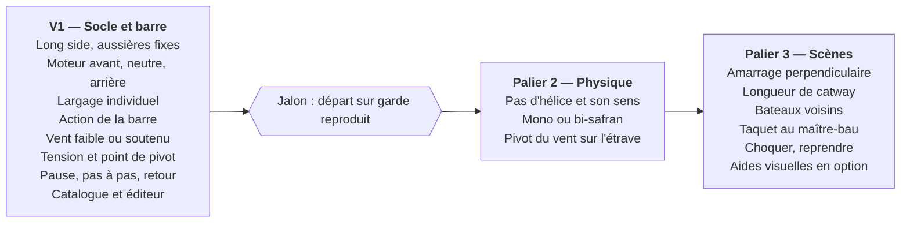

# Mini Cassiopée — Spécifications

Document de référence du projet. Toute évolution du périmètre doit y être reportée, dans la même demande de fusion que le code concerné.

## Vision et objectif

Mini Cassiopée est une application web qui permet à un élève de comprendre, seul et sur son téléphone, comment un voilier amarré translate et pivote sous l'effet du moteur, de la barre, du vent et des aussières.

Elle reproduit et enrichit un outil pédagogique utilisé par une monitrice de voile : un morceau de tissu en forme de bateau vu de dessus, avec des fils de laine fixés à la coque en guise d'aussières. Posé sur une table, on bloque les fils comme s'ils étaient tournés sur un quai, puis on simule la marche avant ou arrière, avec ou sans vent, pour observer le comportement du bateau.

Le nom « Mini Cassiopée » est définitif : il rend hommage au petit bout de tissu et au bateau du stage, *Cassiopée*, lors du stage effectué avec cette monitrice.

L'objectif est de garder la simplicité de cet outil tout en ajoutant ce que le tissu ne permet pas : rejouer une manœuvre, l'arrêter, revenir en arrière, voir la tension des aussières et le point de pivot.

## Principes directeurs

Ces principes arbitrent toutes les décisions de conception, en particulier lors des ajouts de fonctionnalités.

1. **Le bout de tissu d'abord.** Toute situation doit pouvoir se décrire aussi simplement que sur la table : un bateau, un quai, quelques aussières, un sens de moteur.
2. **Des principes, pas un bateau réel.** La physique est qualitativement correcte : le bateau part dans le bon sens, pivote autour du bon point, avec des ordres de grandeur plausibles. Aucune valeur réelle (kN, nœuds) n'est affichée ni garantie.
3. **Le point de pivot est l'information centrale.** C'est ce que l'outil doit rendre visible avant tout.
4. **La complexité est optionnelle.** Chaque enrichissement (pas d'hélice, bi-safran, bateaux voisins, choquer une aussière…) s'active dans des paramètres avancés ; désactivé, le comportement de base reste inchangé.
5. **Construction par paliers.** On livre un socle utilisable, puis on enrichit au fur et à mesure, sans basculer dans une simulation fine.
6. **Mobile d'abord.** L'outil doit être utilisable au port ou à bord, sur un téléphone, sans autre matériel.

## Utilisateurs et cas d'usage

L'utilisateur principal est l'élève, en autonomie, qui teste des scénarios. Le moniteur peut s'en servir pour une démonstration, mais l'outil n'est pas conçu pour un cours magistral ou une projection en salle.

| Utilisateur | Contexte | Support |
| --- | --- | --- |
| Élève en autonomie | Révision avant une sortie, débrief le soir au port | Smartphone, tablette |
| Moniteur | Démonstration ponctuelle à un élève ou un petit groupe | Smartphone, tablette |
| Concepteur (Jp) | Usage personnel, mise au point des scénarios | PC, tablette |

Deux familles de scénarios sont couvertes :

- **Manœuvre** : l'élève prépare une situation, lance la simulation, agit sur le moteur, la barre et les amarres, et observe la réaction du bateau (exemple : départ sur garde).
- **Vérification d'amarrage** : l'élève ne touche à aucune commande et laisse agir le vent seul, pour voir si l'amarrage tient et quelles aussières travaillent.

## Scène simulée

La scène se compose d'un seul bateau, d'un quai, d'aussières et du vent. Chaque élément a un réglage de base et des options avancées.

### Bateau

- Un modèle unique et générique, aux proportions d'un voilier de croisière de 10 m.
- Taquets : au minimum un à l'étrave et un à l'arrière ; option pour en ajouter au maître-bau.
- Paramètres avancés : pas d'hélice activable, avec choix du sens de rotation ; choix entre mono-safran et bi-safran.
- Le type de quille n'est pas paramétrable.

### Quai et environnement

- Amarrage le long du quai (long side) ou perpendiculaire au quai.
- En perpendiculaire : longueur du catway réglable par rapport à la longueur du bateau.
- Option : bateaux voisins de part et d'autre, pour tester les points de pivot et les risques de contact.
- Points d'amarrage côté quai : position définie par la situation choisie ou ajustée dans l'éditeur.

### Aussières

- Chaque aussière relie un taquet du bateau à un point du quai.
- Par défaut, sa longueur est fixée à la position de départ ; elle est soit tendue, soit molle.
- Larguée, elle disparaît de la scène (considérée comme remontée à bord).
- Palier avancé : choquer ou reprendre une aussière pendant la manœuvre, pour conserver de la tension ou créer un point de pivot.

### Vent

- Direction et force fixées pendant la préparation, constantes pendant la simulation.
- Force exprimée de façon qualitative, par exemple faible ou soutenu, avec un effet plus ou moins marqué sur le bateau.
- Palier avancé : appui du vent sur l'étrave provoquant un pivot (effet de fardage).

## Modèle de simulation

La simulation est en deux dimensions, vue de dessus, et vise un comportement qualitativement juste plutôt qu'une précision physique.

- **Forces prises en compte dans le socle** : poussée du moteur (avant ou arrière, intensité unique), effort de la barre sur le safran quand le bateau a de l'erre ou que le flux de l'hélice passe sur le safran, force du vent, retenue des aussières tendues, contact avec le quai.
- **Mouvements** : translation dans le plan et rotation autour d'un axe vertical. Le point de pivot résulte des aussières tendues et des points de contact.
- **Aussières** : longueur maximale fixe ; une aussière ne retient que lorsqu'elle est tendue, jamais en compression.
- **Contact avec le quai** : traitement simple qui empêche le bateau de traverser le quai et peut servir de point d'appui ; les défenses ne sont pas modélisées dans le socle.
- **Amortissement** : le bateau ralentit naturellement dans l'eau, pour éviter des oscillations ou des glissements irréalistes.
- **Effets avancés, désactivés par défaut** : pas d'hélice selon le sens de rotation, différence mono/bi-safran, pivot sous l'effet du vent sur l'étrave.
- **Reproductibilité** : à conditions de départ et actions identiques, la simulation produit le même résultat. C'est la condition du pas à pas et du retour arrière.

## Commandes et interactions

L'application a deux modes : la **préparation**, où l'on règle la situation, et la **simulation**, où l'on manœuvre et observe.

### Pendant la simulation

| Commande | Valeurs | Palier |
| --- | --- | --- |
| Moteur | Avant, neutre, arrière (sans réglage de puissance) | Socle |
| Larguer une aussière | Individuellement, à tout moment | Socle |
| Barre | Angle de barre, côté bâbord ou tribord | V1 |
| Ne rien faire | Laisser agir le vent seul | Socle |
| Choquer ou reprendre une aussière | Allonger ou raccourcir pendant la manœuvre | Avancé |

### Contrôle du déroulement

- Lecture, pause.
- Avance pas à pas.
- Retour arrière (rewind) jusqu'à n'importe quel instant de la manœuvre en cours.
- Réinitialisation à la situation de départ.

Les commandes doivent être utilisables au doigt sur un écran de téléphone, d'une seule main si possible.

## Interface et visualisation

L'écran de simulation est une vue de dessus 2D, la plus épurée possible, dans l'esprit d'un schéma plutôt que d'un rendu réaliste.

Éléments affichés :

- le bateau, le quai et, en option, le catway et les bateaux voisins ;
- les aussières, avec un code couleur tendue / molle ;
- la position de la commande moteur (avant, neutre, arrière) et, à partir de la V1, l'angle de barre ;
- la direction et la force du vent ;
- quand le bateau pivote : le point de pivot marqué sur la coque et une flèche de rotation à une extrémité du bateau.

Rien d'autre n'est affiché par défaut. Toute aide visuelle supplémentaire (trajectoire, flèches de forces, position fantôme de départ) devra être optionnelle.

## Préparation des situations

L'élève part d'un catalogue de situations types, qu'il peut ajuster dans un petit éditeur avant de lancer la simulation.

### Catalogue

Chaque situation définit : la configuration du quai (le long ou perpendiculaire, longueur de catway), la position du bateau, les aussières en place et celles qui sont tendues au démarrage, le vent, et les options avancées actives. Contenu initial proposé, à valider :

- amarré le long du quai, quatre amarres (pointes et gardes), sans vent : vérification d'amarrage ;
- même situation avec vent du quai, puis vent du large ;
- départ sur garde avant ;
- départ sur garde arrière ;
- amarré perpendiculaire, sur catway court puis long.

### Éditeur

- Déplacer le bateau le long du quai.
- Ajouter, retirer ou déplacer une aussière entre un taquet du bateau et un point du quai.
- Indiquer pour chaque aussière si elle est tendue au moment de la mise en mouvement.
- Régler la direction et la force du vent.
- Activer les options avancées.

Aucune sauvegarde ni partage de situation n'est prévu à ce stade. Le stockage local dans le navigateur est envisageable (par exemple pour retrouver la dernière situation).

## Exigences techniques et non fonctionnelles

| Thème | Exigence |
| --- | --- |
| Plateformes | Navigateur web sur PC, Android et iOS |
| Architecture | Fonctionnement entièrement dans le navigateur, sans serveur applicatif |
| Stockage | Aucun obligatoire ; stockage local du navigateur possible |
| Hors-ligne | Souhaitable, pour un usage au port avec une couverture réseau faible |
| Affichage | Adapté aux petits écrans tactiles, en portrait comme en paysage |
| Performance | Animation fluide sur un smartphone milieu de gamme |
| Langue | Interface en français uniquement |
| Stack | Voir le [document d'architecture](architecture.md) |
| Licence | Code sous licence MIT, diffusion et redistribution libres |
| Données personnelles | Aucune collecte, aucun compte utilisateur |

## Feuille de route par paliers

Le projet avance par paliers : la V1 livre un socle utilisable et l'action de la barre, puis chaque palier ajoute des options sans changer le comportement de base.

La V1 est validée par le jalon du départ sur garde (voir les critères d'acceptation). L'ordre des paliers 2 et 3 est une proposition, à ajuster selon les retours des élèves.

## Critères d'acceptation de la V1

La V1 est réussie quand un élève reproduit sur son téléphone un départ sur garde complet, en deux phases, et que le bateau se comporte comme le bateau en tissu.

- [ ] Positionner le bateau le long d'un quai.
- [ ] Placer les aussières et indiquer lesquelles sont tendues au moment de la mise en mouvement.
- [ ] Piloter le moteur (avant, neutre, arrière) pendant la simulation.
- [ ] Agir sur la barre pendant la simulation.
- [ ] Larguer chaque aussière individuellement pendant la simulation.
- [ ] Voir la tension des aussières (tendue / molle) et le point de pivot.
- [ ] Mettre en pause, avancer pas à pas, revenir en arrière.
- [ ] Phase 1 du départ sur garde : en appui sur la garde, le moteur fait pivoter le bateau autour de l'extrémité retenue, l'autre extrémité s'écarte du quai.
- [ ] Phase 2 : moteur dans l'autre sens, garde larguée, le bateau se dégage du quai.
- [ ] Vérification d'amarrage : sans commande, avec du vent, l'amarrage tient et les aussières qui travaillent sont visibles.
- [ ] Fonctionnement sur PC, Android et iOS.

Restent hors V1 : pas d'hélice, choix mono/bi-safran, choquer ou reprendre une aussière, pivot par le vent sur l'étrave, bateaux voisins.

## Hors périmètre

Sont exclus du projet, sauf décision contraire reportée dans ce document :

- simulation physique fine ou valeurs chiffrées réalistes (forces, vitesses) ;
- usage en cours magistral ou en projection ;
- comptes utilisateurs, serveur, sauvegarde en ligne et partage de situations ;
- vent variable pendant une simulation (rafales, bascules) ;
- rendu 3D ou réaliste ;
- plusieurs modèles de bateaux ;
- interface dans une autre langue que le français.

Les points suivants n'ont pas été tranchés et figurent dans les points ouverts : courant, houle, marnage, manœuvres sans quai (mouillage, bouée).

## Glossaire

| Terme | Définition dans le projet |
| --- | --- |
| Aussière | Cordage reliant un taquet du bateau à un point du quai |
| Pointe avant / arrière | Aussière partant de l'avant (ou de l'arrière) du bateau vers l'avant (ou l'arrière) sur le quai |
| Garde avant / arrière | Aussière partant de l'avant (ou de l'arrière) du bateau, frappée vers l'arrière (ou l'avant) sur le quai ; limite les mouvements longitudinaux |
| Traversier | Aussière perpendiculaire au bateau, qui le tient contre le quai |
| Larguer | Détacher une aussière ; dans l'appli, elle disparaît de la scène |
| Choquer / reprendre | Donner du mou à une aussière / la raccourcir |
| Point de pivot | Point autour duquel le bateau tourne à un instant donné |
| Pas d'hélice | Poussée latérale de l'hélice, surtout en marche arrière, qui fait dériver l'arrière d'un côté |
| Fardage | Prise au vent de la coque et du gréement |
| Maître-bau | Partie la plus large du bateau |
| Long side | Amarrage le long du quai, flanc contre le quai |
| Catway | Petit ponton perpendiculaire au quai, le long duquel le bateau est amarré |

## Points ouverts

- [ ] Courant, houle et marnage : à exclure définitivement ou à garder comme enrichissements lointains ?
- [ ] Manœuvres sans quai (mouillage, bouée) : dans ou hors du projet ?
- [ ] Licence des contenus pédagogiques (situations, textes) : CC0 proposée.
- [ ] Contenu définitif du catalogue de situations de la V1, à valider avec la monitrice.
- [ ] Réglage de la barre : quelques positions fixes ou un angle continu ?
- [ ] Défenses : à représenter un jour, ou le contact simple avec le quai suffit-il ?
- [ ] Aides visuelles optionnelles (trajectoire, flèches de forces, position fantôme) : lesquelles retenir, et à quel palier ?
